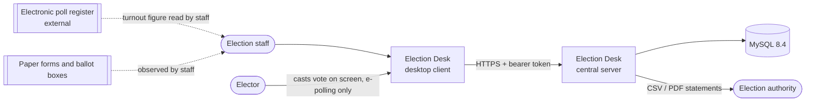
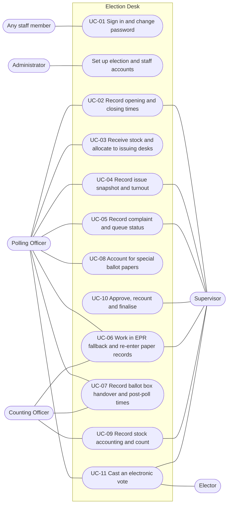
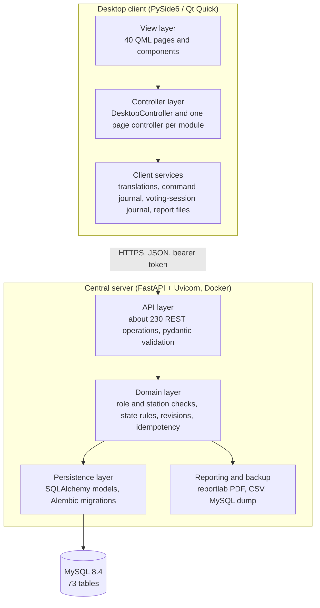
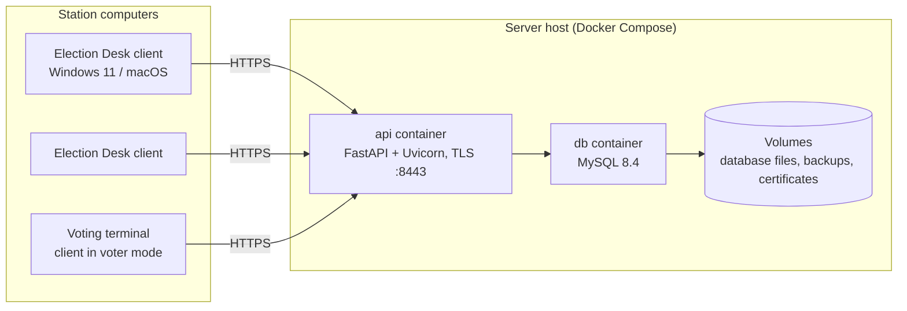
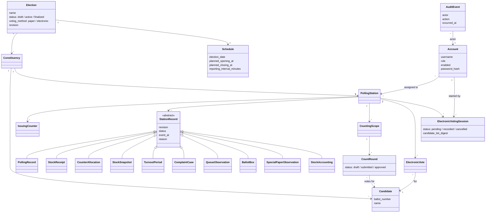
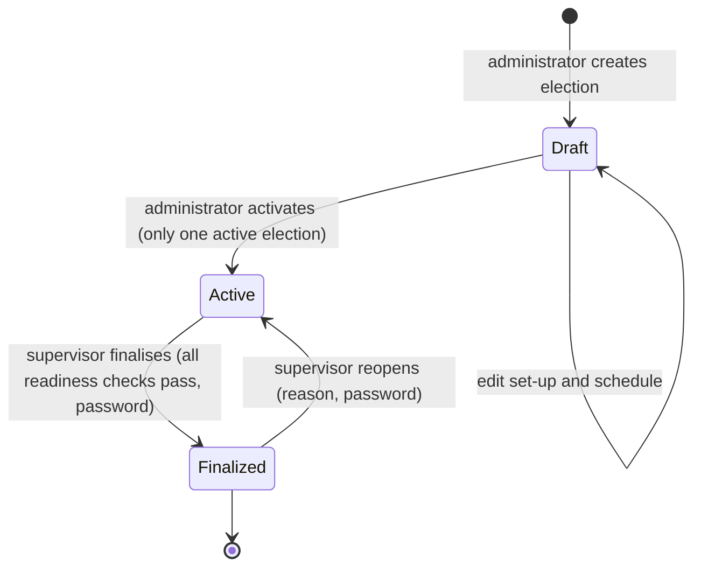
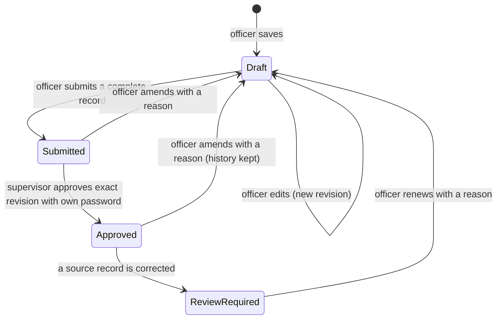
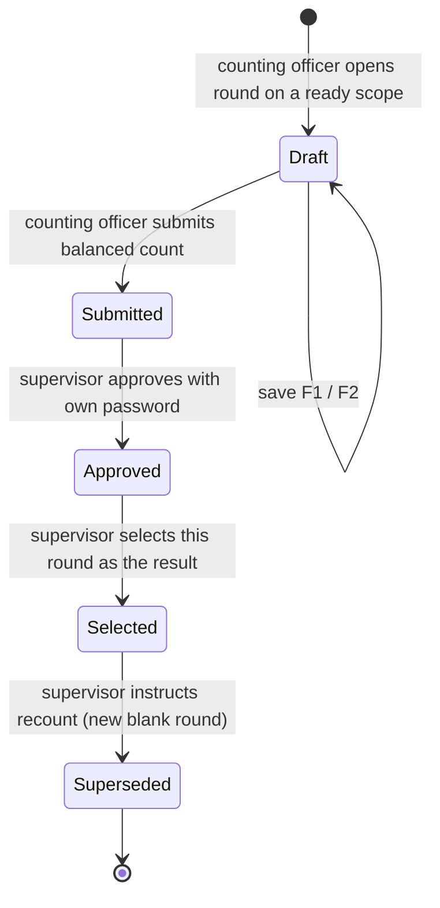

# Election Desk — Software Requirements and Design Overview

COMP 8500SEF Software Engineering · Group 61 · Topic 2: Election Management and Voting System

Repository: https://github.com/dennisngan/election-management-and-voting-system (release `v1.1.0`)

> Status of this document set: written from the source code of release `v1.0.0` and from the
> group's reference operating manual, then updated for release `v1.1.0` (21 November 2026),
> which added in-person electronic voting (document 14). Every item marked `TODO(group)` must be confirmed or
> filled in by the responsible member before submission.

## 1. Document map

| File | Content | Person in charge |
| --- | --- | --- |
| `00-overview.md` | Scope, stakeholders, process, system-level requirements, architecture and models | All |
| `01-login-and-layout.md` | Sign-in, first login, staff accounts, basic layout | Rico |
| `02-polling-times.md` | Polling station opening and closing times | Dennis |
| `03-stock-and-allocations.md` | Ballot paper stock and issuing desks (P(14)) | Harriet |
| `04-snapshots-and-turnout.md` | Ballot issue snapshots (P(12)) and hourly turnout (P(15)) | Toby |
| `05-complaints-and-queue.md` | Complaint cases (P(19)) and queue status | John |
| `06-failure-handling.md` | EPR fallback, outages, paper re-entry and recovery | Mody |
| `07-post-poll-times.md` | Times of actions after the poll, ballot box handover | Lam |
| `08-special-papers.md` | Tendered, spoilt and unused ballot papers | Salina |
| `09-count-reports.md` | Stock accounting (P(18)) and count forms F1–F4 | Toby |
| `10-recount-and-completion.md` | Recounts, constituency results and election completion | Lam |
| `11-traceability-matrix.md` | Requirement → design → code → test | All |
| `12-testing-strategy.md` | Test levels, techniques and execution record | All |
| `13-evolution-plan.md` | Change management, maintenance and retirement | All |
| `14-e-polling.md` | In-person electronic voting (e-polling) and live station totals, added in v1.1.0 | Dennis |

## 2. Purpose and scope

Election Desk is a desktop system for election staff at polling and counting stations. The
administrator chooses one voting method for each election:

- Physical ballots (the default). Electors vote on paper. The system does not cast or store
  votes. It records what staff do and observe: opening and closing times, ballot paper stock,
  issue snapshots, turnout, complaints, queue status, ballot box handover, special ballot
  papers, the count, recounts and the final result (documents 02 to 10).
- E-polling (added in release v1.1.0). Electors vote in person on a terminal that a polling
  officer opens for them. The system stores each electronic vote with no link to the elector,
  the voting session or the officer, and shows the supervisor the running station totals
  (document 14).

In scope:

- Election set-up by an administrator (election, voting method, constituencies, candidates,
  stations, issuing desks, schedule, staff accounts).
- Polling-day and counting-night records for each station, with supervisor approval.
- Statements in CSV and PDF, in Traditional Chinese, Simplified Chinese and English.
- In-person electronic voting at a station terminal, and live station totals for the
  supervisor.

Out of scope:
- Remote or online voting (voting outside a polling station).
- Public result publication.
- For e-polling elections in v1.1.0: turnout reports, constituency results and election
  completion (document 14, section 8).

## 3. Source of requirements

The requirements were elicited from an existing operating manual for a polling-station
information system, which the group translated and divided by chapter
(`docs/reference-manual.md`, based on the polling-station operating manual provided for
COMP 8500SEF Topic 2). The manual describes how staff use an existing tablet system. It is a description of
current practice, so the group treated it as the result of requirements discovery
(document analysis) and then performed classification, prioritisation and specification.

Decisions taken when turning the manual into requirements:

| Manual (existing system) | Election Desk (our system) | Reason |
| --- | --- | --- |
| Tablet application | Desktop client (Windows 11, macOS) with a central server | No tablet fleet or MDM is available to a course project; a desktop client can be installed by any member |
| Accounts | Four roles: Administrator, Polling Officer, Counting Officer, Supervisor | Separation of duties: the person who enters a figure is not the person who approves it |
| Password of 8 or more characters with complexity rules | Password of 12 to 128 characters, different from the current password | Length is a stronger and simpler rule than composition rules |
| Records uploaded to Central Server | Records saved on a central server immediately and approved by the Supervisor | One shared source of truth for all desks |
| One language | Three languages, switchable at run time | Requirement of the Hong Kong context |
| Screens only | Screens plus CSV and PDF statements | Paper evidence is still required on election night |
| Paper ballots only | Paper ballots or in-person e-polling, chosen for each election | The topic is an election management and voting system. E-polling is not in the manual; it was specified by the group and added as a new increment in v1.1.0 |

## 4. Stakeholders and user roles

| Stakeholder | Interest | System role |
| --- | --- | --- |
| Election administrator | Prepares the election before polling day and manages staff accounts | `administrator` — set-up only, no access to operational records |
| Polling staff | Records station work during the poll | `polling_officer` |
| Counting staff | Records stock accounting and the count | `counting_officer` |
| Presiding officer | Reviews and approves records, orders recounts, finalises | `supervisor` |
| Electors | Secrecy of the vote; a vote that is counted exactly once | No account. In an e-polling election the elector uses the voting screen that a polling officer opens |
| Candidates | Trustworthy, auditable figures | No account (indirect stakeholders) |
| Election authority | Audit trail, retention of records | No account (indirect stakeholder) |

Operational roles only see the stations they are assigned to. All writes apply to the single
active election.

## 5. Software process

The group followed an incremental development process with a plan-driven requirements baseline
(Lecture 2, incremental development; Lecture 3, plan-driven versus agile):

1. Specification. The reference manual was divided into ten functional areas, one per member
   (see the table in section 1). Each area is one increment.
2. Development. Increments were implemented on the `main` branch in small commits
   (830 commits between 22 October and 21 November 2026). An AI coding assistant was used for
   implementation under the instructions in `AGENTS.md`; the group reviewed the result against
   the requirements.
3. Validation. Each of the ten paper-ballot increments was checked by automated tests at unit,
   API and user-interface level, and by a scripted demonstration scenario (`demo/README.md`).
   The automated tests are no longer in the repository (document 12, section 3).
4. Evolution. Release `v1.0.0` was tagged on 17 November 2026. Release `v1.1.0` (21 November
   2026) added an eleventh increment, e-polling, as a functionality addition. It has a demo
   scenario but no automated tests. Later changes follow the change process in
   `13-evolution-plan.md`.

Process activities and where their evidence is kept:

| Activity (Lecture 2) | Evidence |
| --- | --- |
| Software specification | `docs/01` to `docs/10` and `docs/14`, section 6 of this document |
| Software design and implementation | Sections 7 to 9 of this document, `src/` |
| Software validation | `docs/12-testing-strategy.md`, test cases in each module document |
| Software evolution | `docs/13-evolution-plan.md`, GitHub releases |

## 6. System-level requirements

### 6.1 Functional requirements shared by every module

| ID | Requirement | Implemented in |
| --- | --- | --- |
| FR-SYS-01 | The system shall reject every request that does not carry a valid session, except sign-in and the health check. | `server/app.py` (401 `session_expired`) |
| FR-SYS-02 | The system shall allow an operational user to read and write only the stations assigned to that user. | `server/station_access.py` (403 `station_access_denied`) |
| FR-SYS-03 | The system shall accept writes only for the single active election, and shall make a finalised election read-only. | `server/station_access.py`, `server/lifecycle.py` (409 `active_election_required`) |
| FR-SYS-04 | The system shall keep every saved revision of a record. A correction creates a new revision and shall require a reason. | `*_models.py` revision tables |
| FR-SYS-05 | The system shall require the Supervisor to re-enter their own password when approving a record, and shall approve only the exact revision that was submitted. | `verify_password` calls in `polling.py`, `turnout.py`, `accounting.py`, `counting_workflow.py` and others |
| FR-SYS-06 | The system shall produce a statement of a saved record as an on-screen preview, a CSV file and a PDF file in the language selected by the user. | `server/*_reports.py`, `desktop/report_files.py` |
| FR-SYS-07 | The system shall record an audit event (actor, action, time) for sign-in, sign-out, password change and every write. | `audit_events` table |

### 6.2 Non-functional requirements

Each requirement is written so that it can be tested (Lecture 4, metrics for non-functional
requirements).

| ID | Type | Requirement | Measure / how verified |
| --- | --- | --- | --- |
| NFR-SEC-01 | Security | All traffic between client and server shall use HTTPS, and the client shall verify the server certificate against the configured certificate authority. | Client started with a wrong `--ca` file cannot sign in |
| NFR-SEC-02 | Security | Passwords shall be stored only as Argon2 hashes and session tokens only as SHA-256 digests. No response, statement or audit entry shall contain a password. | Inspection of `accounts` and `sessions` tables; API tests |
| NFR-SEC-03 | Security | A session shall expire exactly 24 hours after sign-in and shall be revoked by sign-out, by a password change and by a change of role or station assignment. | API test with a controlled clock |
| NFR-SEC-04 | Security | Role and station checks shall be enforced on the server for every route, not only in the user interface. | Direct API call with the wrong role returns 403 |
| NFR-REL-01 | Reliability | When two clients edit the same record revision, exactly one shall succeed; the other shall receive `revision_conflict` and no data shall be lost. | Concurrency API tests |
| NFR-REL-02 | Reliability | Repeating a command with the same request identifier shall have exactly one effect. The same identifier with different content shall be rejected with `request_conflict`. | Replay API tests |
| NFR-REL-03 | Reliability | Saved records shall survive a restart of the server and the client. | Restart tests; demo restart |
| NFR-REL-04 | Reliability | If the database is unavailable the server shall answer 503 `database_unavailable` without a partial write, and the client shall keep the uncertain command for later recovery. | Fault-injection test; Recovery page |
| NFR-USA-01 | Usability | Every screen and statement shall be available in Traditional Chinese, Simplified Chinese and English, switchable without restarting. | about 1,800 translation keys in each language; inspection |
| NFR-USA-02 | Usability | All times shall be shown in Hong Kong Time and stored in UTC. | Inspection of statements |
| NFR-USA-03 | Usability | A trained officer shall be able to record one routine entry (for example a queue observation) in under 60 seconds. | `TODO(group)`: time three members on the demo |
| NFR-PERF-01 | Performance | 95% of API requests on the demo data set shall complete within 1 second on a local network. | `TODO(group)`: measure on the demo; target only |
| NFR-PORT-01 | Portability | The client shall run on Windows 11 x64 and macOS (Apple silicon and Intel). The server shall run in Docker. | GitHub Actions build `build-desktop.yml` |
| NFR-DATA-01 | Accuracy | Ballot serial numbers shall be handled as exact digit strings of up to 18 digits and quantities as exact integers. | Boundary tests with leading zeros and large numbers |
| NFR-MNT-01 | Maintainability | All code shall pass `ruff` and `mypy --strict`. The database schema shall change only through Alembic migrations. | `pyproject.toml`; 36 migrations |
| NFR-BKP-01 | Recoverability | An administrator shall be able to request a server-side database backup, and a backup shall be restorable into a separate test schema. | `server/backups.py`, `server/backup_restore.py` |
| NFR-PRIV-01 | Privacy | An electronic vote shall not be linkable to an elector, a voting session, a staff account or a time. The voting terminal shall never write the chosen candidate to disk. | Inspection of table `electronic_votes` and of the terminal's journal file (TC-EPL-14) |

## 7. Context and use case models

### 7.1 Context model

The EPR and the paper forms are outside the system boundary. Staff copy figures from them.
The elector is a direct user only in an e-polling election, and only of the voting screen.

### 7.2 Use case diagram

"Any staff member" stands for all four roles: every role signs in through UC-01. The Supervisor takes part in UC-02, UC-04, UC-05, UC-06 and UC-09 as the approver and is the main actor of UC-10.

UC-11 exists only in an e-polling election: the Polling Officer starts the voting session, the
Elector casts the vote and the Supervisor watches the live totals. UC-03, UC-04 and UC-07 to
UC-10, and the fallback part of UC-06, apply to physical-ballot elections only. UC-01, UC-02,
UC-05 and the outage records of UC-06 apply to both.

## 8. Architectural design

### 8.1 Architectural pattern

Election Desk uses the client–server pattern (Lecture 6). Many desks must see the same records
at the same time, so the data is held by one server and the clients hold none. Inside the
server and the client the code is layered. The central database acts as a repository shared by
all functional modules.

| Layer | Technology | Responsibility |
| --- | --- | --- |
| View | QML, Qt Quick Controls (Material style) | Screens, forms, dialogs; no business rules |
| Controller | Python `QObject` classes in `src/election/desktop` | Turns user actions into API requests; holds page state |
| API | FastAPI routers in `src/election/server` | Input validation, authentication, error codes |
| Domain | Python functions in the same modules | Authorisation, workflow states, conservation rules |
| Persistence | SQLAlchemy 2, PyMySQL, Alembic | Tables, revisions, request receipts |
| Data | MySQL 8.4 in Docker | Durable storage |

In the client the three upper layers follow Model–View–Controller: QML pages are the views,
page controllers are the controllers, and the model is the server state returned by the API.

### 8.2 Architectural design decisions

| Decision | Alternatives considered | Reason |
| --- | --- | --- |
| Desktop client with a central server | Web application; stand-alone desktop with a local database | Works on a closed station network; no browser dependency; one shared source of truth |
| Client has no database access | Client connects to MySQL directly | Authorisation can only be trusted if it is enforced on the server |
| Immutable revisions instead of updates | Update rows in place | Election records must be auditable; nothing is overwritten |
| Optimistic concurrency with revision numbers | Record locking | Desks must not block each other; conflicts are rare and must be visible |
| Request identifiers on every write | Retry blindly | A lost reply on an unstable network must not create a second record |
| Supervisor password on approval | Role check only | An unattended signed-in desk must not be able to approve |
| Statements rendered on the server | Render in the client | The same saved revision gives the same statement on every desk |
| One voting method for each election; paper-only records are refused in an e-polling election | Mixed paper and electronic voting in one election | Simple rules; paper and electronic totals can never be double-counted |
| An electronic vote is stored with no reference to its voting session | Store the session identifier with the vote | Ballot secrecy is more important than tracing a single vote; "exactly once" is enforced on the session instead |
| The voting terminal is the normal client in voter mode, started by a signed-in Polling Officer | A separate kiosk application; a web page for electors | Reuses sign-in, station assignment and TLS; no new deployment unit |

Note: Documents `docs/00-overview.md` through `docs/14-e-polling.md` supersede earlier draft
notes and serve as the published architecture and specification records (CR-01).

### 8.3 Deployment view

## 9. Structural and behavioural models

### 9.1 Conceptual class diagram

`StationRecord` is a modelling abstraction: in the code each record type has its own head
table and revision table (`*_models.py`).

There is deliberately no association between `ElectronicVotingSession` and `ElectronicVote`:
a vote cannot be traced back to the session, the officer or the elector (NFR-PRIV-01).

### 9.2 State model: election life cycle

### 9.3 State model: reviewed station record

This model applies to polling times, turnout periods, complaint periods, stock accounting and
EPR fallback records. The `ReviewRequired` state applies to records that depend on another
record (turnout, complaint periods, stock accounting).

### 9.4 State model: count round

### 9.5 State model: voting session

See `14-e-polling.md`, section 5.2 (pending, recorded, cancelled).

## 10. Design and implementation notes

- Implementation language: Python 3.14 on both sides; QML for screens.
- Open-source reuse (Lecture 7): PySide6/Qt, FastAPI, SQLAlchemy, Alembic, pydantic,
  argon2-cffi, reportlab, MySQL. No component was written where a maintained library existed.
- Configuration management: Git and GitHub; releases `v1.0.0` and `v1.1.0` are tagged; desktop builds are
  produced by GitHub Actions for Windows 11 x64 and macOS.
- Host–target development: developed on member laptops, deployed with Docker Compose
  (`compose.yaml`, `deploy/`).
- Coding standards: `ruff` and `mypy --strict`, configured in `pyproject.toml`.
- Design patterns visible in the code: Observer (Qt signals between controllers and QML),
  Facade (`DesktopController` in front of the page controllers), Repository (central database).

## 11. Glossary

See `GLOSSARY.md` in the repository root; e-polling terms are also listed in document 14,
section 1. Forms referred to in this document set:

| Form | Meaning |
| --- | --- |
| P(12) | Snapshot of ballot papers issued by each issuing desk |
| P(14) | Control sheet of ballot papers distributed to issuing desks |
| P(15) | Hourly voter turnout |
| P(18) | Ballot paper account after the poll |
| P(19) | Statistics on complaints received |
| F1 | Initial tally: votes per candidate, invalid papers, questionable papers |
| F2 | Determination of questionable papers |
| F3, F4 | Final result forms derived from F1 and F2 |
| EPR | Electronic poll register (external system) |
