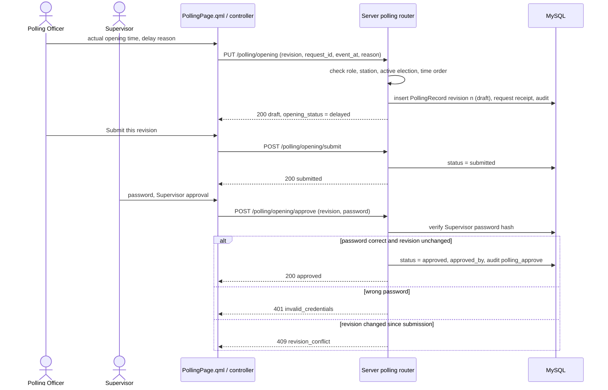

# 02. Polling station opening and closing times

| Item | Value |
| --- | --- |
| Person in charge | Dennis |
| Reference manual | 6.1 Polling station opening and closing time (pp. 37–44) |
| Server code | `src/election/server/polling.py`, `polling_models.py`, `lifecycle.py` |
| Desktop code | `src/election/desktop/polling.py`, `qml/PollingPage.qml`, `qml/LifecyclePage.qml` |
| API | `/api/workspace/stations/{station_id}/polling` (`GET`, `PUT /{kind}`, `POST /{kind}/submit`, `POST /{kind}/approve`, `POST /{kind}/amend`, `GET /{kind}/history`, `GET /audit`) |
| Former automated tests | `tests/test_polling_api.py`, `tests/test_polling_desktop.py` (commit `c68fb54`) |

## 1. User requirements

- UR-02.1 The polling officer records when the station actually opened and whether that was on
  time.
- UR-02.2 At the close of poll the officer records when admission closed, the estimate for
  clearing the queue, and when the last queued elector was served.
- UR-02.3 The presiding officer (Supervisor) confirms each time with their own password.
- UR-02.4 A wrong time can be corrected, but the original entry and the reason stay visible.

## 2. Functional requirements

| ID | Requirement | Role | Implemented in |
| --- | --- | --- | --- |
| FR-POL-01 | The system shall record four polling events per station: actual opening, closure to new arrivals, queue-clear estimate, and completion of service to queued electors. | Polling Officer | `PollingKind` in `polling.py`; `PUT /{kind}` |
| FR-POL-02 | The system shall compare the actual opening time with the planned opening time in the election schedule and show the status "On time", "Delayed" or missing. | Polling Officer | `record_view` (`opening_status`) |
| FR-POL-03 | The system shall require a delay reason before a delayed opening can be submitted. | Polling Officer | `validate_record` |
| FR-POL-04 | The system shall reject an event time in the future and any set of times that is out of order (opening ≤ closure ≤ completion; queue-clear estimate not before closure). | Polling Officer | `validate_record` (422 `polling_validation`) |
| FR-POL-05 | The system shall let the polling officer save a draft and then submit one revision for approval. | Polling Officer | `POST /{kind}/submit` |
| FR-POL-06 | The system shall let only a Supervisor approve a submitted revision, after re-entering the Supervisor's own password. | Supervisor | `POST /{kind}/approve` (403 role check, 401 `invalid_credentials`) |
| FR-POL-07 | The system shall let the polling officer amend a submitted or approved event only with an amendment reason; the amended event becomes a new draft revision and needs approval again. | Polling Officer | `POST /{kind}/amend` |
| FR-POL-08 | The system shall show the revision and approval history of each event, including who entered, submitted and approved it and when. | Polling Officer, Supervisor | `GET /{kind}/history`, `GET /audit` |
| FR-POL-09 | The system shall refuse polling entries until the administrator has saved the election schedule. | Polling Officer | 409 `schedule_not_configured` |

Non-functional requirements that apply: NFR-REL-01, NFR-REL-02, NFR-REL-03, NFR-SEC-04, NFR-USA-02.

## 3. Use case UC-02: Record a late opening

| Field | Description |
| --- | --- |
| Actors | Polling Officer (primary); Supervisor (approver) |
| Description | The station opened later than planned. The officer records the actual time and the reason; the Supervisor approves the record. |
| Data | Actual opening time (Hong Kong time), delay reason, Supervisor password |
| Stimulus | The officer selects "Actual opening" on "Polling operations" |
| Response | The event shows status "Approved" and opening status "Delayed" |
| Pre-condition | The election is active, the schedule is saved, the officer is assigned to the station |
| Post-condition | One approved revision exists; its history lists the entering officer and the approving Supervisor |
| Comments | The Supervisor approves from a Supervisor session; the password is checked again at approval |

Main flow:

1. The officer opens "Polling operations" and selects "Actual opening".
2. The officer enters the actual time and, because it is later than planned, a delay reason.
3. The officer presses "Save event draft", then "Submit this revision".
4. The Supervisor opens the same event, checks the time and reason, enters their password and
   presses "Supervisor approval".
5. The system marks the revision approved and records the audit event.

Alternative flows:

- 2a. Time is on or before the planned time: no reason is needed; status is "On time".
- 3a. Another desk saved the same event first: the system reports a revision conflict; the
  officer reloads and repeats.
- 4a. Supervisor password is wrong: approval is refused and the record stays "Submitted for
  review".
- 5a. The time was wrong: the officer presses "Create amendment draft", gives an amendment
  reason, submits again, and the Supervisor approves the new revision.

## 4. Sequence diagram

## 5. Design notes

- One table of immutable revisions (`PollingRecord`): `kind`, `revision`, `status`,
  `event_at`, `estimated_clear_at`, `reason`, `amendment_reason`, `planned_at`,
  `schedule_revision`, actors and timestamps.
- States: draft → submitted → approved; amendment creates a new draft (see `00-overview.md`
  section 9.3).
- Election completion (document 10) is blocked until "Completion of service" is approved for
  every station.
- Since v1.1.0 the approved records of this module also control e-polling (`voting_service()`
  in `polling.py`): voting sessions can start once the opening is approved, continue after
  "Closure to new arrivals" is approved (the queue is still served), and stop when
  "Completion of service" is approved (document 14, FR-EPL-04).
- Error codes: 403 role required, 409 `polling_state_conflict`, 409 `revision_conflict`,
  409 `request_conflict`, 409 `schedule_not_configured`, 422 `polling_validation`.

## 6. Test cases

**Recorded run — 27 November 2026, 23:45–23:50 HKT.** Using Election Desk v1.1.0
on macOS, with the shared e-polling demo. All six cases passed at
Harbour Community Hall (`DEMO-S01`) in Demo Election — Harbour District. The paper-ballot
rehearsal remains untested. [Station and voting method](evidence/dennis-polling-times/environment.png)

| ID | Requirement | Pre-condition | Steps | Expected result | Result |
| --- | --- | --- | --- | --- | --- |
| TC-POL-01 | FR-POL-01, FR-POL-08 | Signed in as `demo_polling` | Open "Polling operations"; view "Actual opening" and its history. | The seeded opening is shown as "Approved" with entry and approval history | **Pass.** Revision 1 showed “Approved” and “On time” for 20 Nov at 08:00 HKT. History showed account 6 entered and submitted it, and account 5 approved it. [Opening](evidence/dennis-polling-times/TC-POL-01.png) · [History](evidence/dennis-polling-times/TC-POL-01-history.png) |
| TC-POL-02 | FR-POL-05 | Same | Select "Closure to new arrivals"; enter a time after the opening and not in the future; "Save event draft"; "Submit this revision". | Status becomes "Submitted for review" | **Pass.** The officer saved the 20 Nov 18:00 HKT closure as revision 1. Submitting it changed the status to “Submitted for review”. [Draft](evidence/dennis-polling-times/TC-POL-02-draft.png) · [Submitted](evidence/dennis-polling-times/TC-POL-02.png) |
| TC-POL-03 | FR-POL-06 | TC-POL-02 done; signed in as `demo_supervisor` | Open the same event; enter a wrong password and approve; then the correct password. | First attempt refused; second attempt sets "Approved" | **Pass.** The app reported an incorrect password and kept revision 1 at “Submitted for review”. The correct password changed the same revision to “Approved”. [Refusal](evidence/dennis-polling-times/TC-POL-03-refused.png) · [Approval](evidence/dennis-polling-times/TC-POL-03-approved.png) |
| TC-POL-04 | FR-POL-04 | Signed in as `demo_polling` | Create an amendment of "Closure to new arrivals" with a time earlier than the opening. | Rejected with a validation message; saved record unchanged | **Pass.** With a reason supplied, the app rejected 07:59 HKT on 20 Nov and said recorded events must be in order. Reloading showed approved revision 1 at 18:00 HKT. [Input](evidence/dennis-polling-times/TC-POL-04-input.png) · [Validation](evidence/dennis-polling-times/TC-POL-04-rejected.png) · [Reloaded record](evidence/dennis-polling-times/TC-POL-04-reloaded.png) |
| TC-POL-05 | FR-POL-07 | TC-POL-03 done | "Create amendment draft" without a reason, then with a reason. | Without reason: rejected. With reason: new draft revision; old revision still in history | **Pass.** With the corrected time of 18:01 HKT and a blank reason, “Create amendment draft” was disabled. Adding a reason created draft revision 2. History showed the reason and retained approved revision 1 at 18:00 HKT. [Blank reason](evidence/dennis-polling-times/TC-POL-05-no-reason.png) · [New draft](evidence/dennis-polling-times/TC-POL-05-draft.png) · [Both revisions](evidence/dennis-polling-times/TC-POL-05-history.png) · [Saved reason](evidence/dennis-polling-times/TC-POL-05-reason.png) |
| TC-POL-06 | FR-POL-06, NFR-SEC-04 | Signed in as `demo_counting` | Open "Polling operations". | Records are readable; no save, submit or approve is possible | **Pass.** The Counting Officer could read the closure draft and its approved predecessor. The desktop form offered no save, submit or approval action. [Counting Officer view](evidence/dennis-polling-times/TC-POL-06.png) · [Readable history](evidence/dennis-polling-times/TC-POL-06-history.png) |

Equivalence partitions for the opening time: before or equal to planned (on time, no reason),
after planned and not in the future (delayed, reason required), in the future (invalid).

Automated tests (unit / API level, from the project history):

| Test | Requirement |
| --- | --- |
| `test_polling_api.py::test_late_opening_draft_is_reviewed_amended_and_preserved_after_restart` | FR-POL-02, FR-POL-03, FR-POL-07, NFR-REL-03 |
| `test_polling_api.py::test_supervisor_approval_requires_own_password_and_exact_submitted_revision_even_on_replay` | FR-POL-06 |
| `test_polling_api.py::test_invalid_polling_time_order_or_inputs_never_replace_saved_events` | FR-POL-04 |
| `test_polling_api.py::test_two_clients_cannot_duplicate_or_overwrite_the_same_opening_revision` | NFR-REL-01 |
| `test_polling_api.py::test_command_replays_return_the_original_outcome_without_duplicate_history_or_audit` | NFR-REL-02 |
| `test_polling_api.py::test_direct_polling_api_rejects_wrong_role_station_and_unready_sessions` | NFR-SEC-04 |

## 7. Differences from the reference manual

| Manual | Election Desk | Reason |
| --- | --- | --- |
| "Open on time" / "Not open on time" chosen by the user | Status derived from actual time against the schedule | Removes a possible inconsistency between the choice and the time |
| If the signed-in account is not the PRO, the PRO types a password on the same screen | The Supervisor approves from their own session and re-enters their own password | Each action is attributed to one account in the audit trail |
| One closing time | Three closing events: closure to new arrivals, queue-clear estimate, completion of service | Electors already queuing at the close of poll may still vote; the three times differ |
