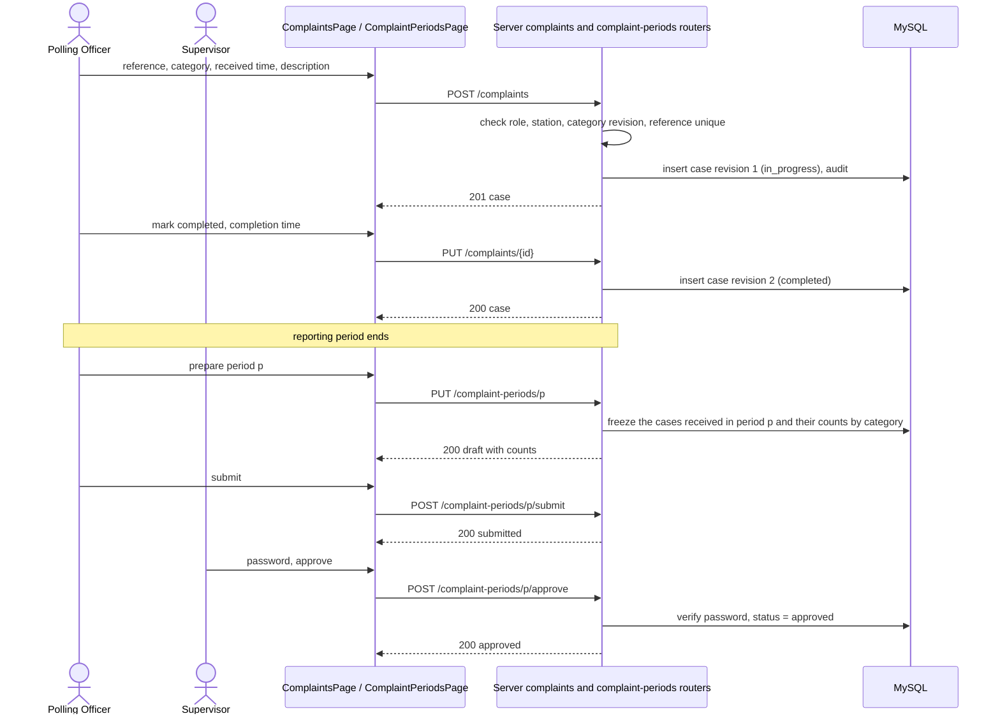
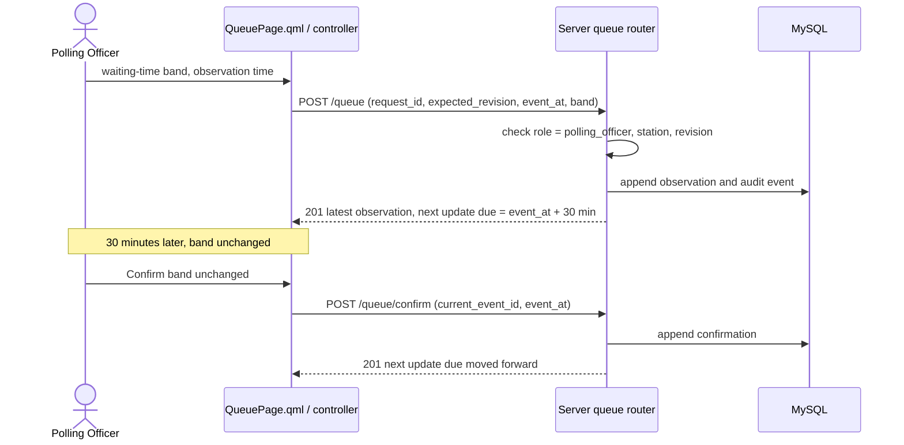

# 05. Complaint cases (P(19)) and queue status

| Item | Value |
| --- | --- |
| Person in charge | John |
| Reference manual | 6.5 P(19) Statistics on complaints received; 6.6 Polling station queue status (pp. 60–70) |
| Server code | `src/election/server/complaints.py`, `complaint_categories.py`, `complaint_periods.py`, `complaint_reports.py`, `queue.py`, `queue_reports.py` |
| Desktop code | `src/election/desktop/complaints.py`, `complaint_periods.py`, `complaint_categories.py`, `queue.py`, `qml/ComplaintsPage.qml`, `qml/ComplaintPeriodsPage.qml`, `qml/ComplaintCategoriesPage.qml`, `qml/QueuePage.qml` |
| API | `/api/workspace/stations/{station_id}/complaints`, `/complaint-periods`, `/queue`; `/api/elections/{election_id}/complaint-categories` |
| Former automated tests | `tests/test_complaints_api.py`, `tests/test_complaint_periods_api.py`, `tests/test_complaint_reports.py`, `tests/test_queue_api.py`, `tests/test_queue_reports.py`, `tests/test_qml_complaints.py`, `tests/test_qml_queue.py` (commit `c68fb54`) |

## 1. User requirements

- UR-05.1 The polling officer records each complaint with its category and the time it was
  received, and later marks it as dealt with.
- UR-05.2 After each reporting period the officer submits the complaint statistics for that
  period, and the Supervisor approves them.
- UR-05.3 Every 30 minutes the officer records how long electors are waiting, even when the
  waiting time has not changed.
- UR-05.4 The administrator maintains the list of complaint categories.

## 2. Functional requirements

Complaints:

| ID | Requirement | Role | Implemented in |
| --- | --- | --- | --- |
| FR-CMP-01 | The system shall record a complaint case with a unique case reference, received time, category, description and work status ("in progress" or "completed"). | Polling Officer | `POST /complaints` (`ComplaintInput`) |
| FR-CMP-02 | The system shall provide a default list of complaint categories for each election and let the administrator add, rename and disable categories. An "other" category shall always remain and shall require a description. | Administrator | `complaint_categories.py` (`DEFAULT_CATEGORIES`) |
| FR-CMP-03 | The system shall let the officer mark a case as completed with a completion time, and amend a case only with a reason, keeping its history. | Polling Officer | `PUT /complaints/{id}`, `POST /complaints/{id}/amend`, `GET /complaints/{id}/history` |
| FR-CMP-04 | The system shall keep the category name a case was recorded under, even if the category is later renamed or disabled. | Polling Officer | `complaint_models.py` (pinned labels) |
| FR-CMP-05 | The system shall assign each case to a reporting period by its received time and count the cases of each period by category. | Polling Officer | `complaint_periods.py`, `reporting_periods.py` |
| FR-CMP-06 | The system shall allow a period to be prepared, submitted after the period has ended, and approved by a Supervisor with password. A period with no complaints shall be submitted as an explicit zero. | Polling Officer, Supervisor | `PUT /complaint-periods/{period}`, `/submit`, `/approve` |
| FR-CMP-07 | The system shall mark an approved period as needing renewal when a case is recorded later with a received time inside that period. | Polling Officer | `complaint_periods.py` |
| FR-CMP-08 | The system shall export complaint statistics for the station and for one period as CSV and PDF. | All operational roles | `complaint_reports.py` |

Queue:

| ID | Requirement | Role | Implemented in |
| --- | --- | --- | --- |
| FR-QUE-01 | The system shall record a queue observation with observation time and one of four waiting-time bands: under 30 minutes, 30–59 minutes, 60–90 minutes, over 90 minutes. | Polling Officer | `POST /queue` (`QueueBand`) |
| FR-QUE-02 | The system shall let the officer confirm that the band is unchanged, and shall store the confirmation as its own history entry. | Polling Officer | `POST /queue/confirm` |
| FR-QUE-03 | The system shall show when the next update is due (30 minutes after the latest observation or confirmation) and how many 30-minute intervals have passed if it is overdue. | All operational roles | `queue_freshness` in `queue.py` |
| FR-QUE-04 | The system shall keep the history of all observations and confirmations and shall not let a back-dated entry replace the latest one. | Polling Officer | `queue_models.py` |
| FR-QUE-05 | The system shall export the queue history as CSV and PDF. | All operational roles | `queue_reports.py` |

Non-functional requirements that apply: NFR-USA-03 (one routine entry within 60 seconds),
NFR-REL-01, NFR-REL-02, NFR-SEC-04, NFR-USA-01.

## 3. Use case UC-05: Record a complaint and submit the period statistics

| Field | Description |
| --- | --- |
| Actors | Polling Officer (primary); Supervisor (approver) |
| Description | An elector complains at the station. The officer records the case. After the reporting period ends, the officer submits the statistics of the period and the Supervisor approves them. |
| Data | Case reference, received time, category, description, work status, completion time; Supervisor password |
| Stimulus | A complaint is received; later, the reporting period ends |
| Response | The case appears in the case list; the period statistics show the count per category and become "Approved" |
| Pre-condition | The election is active; the officer is assigned to the station |
| Post-condition | The case and its history are stored; the approved period lists exactly the cases it counted |
| Comments | Handling the complaint itself happens outside the system |

Main flow:

1. The officer opens "Complaint cases" and adds a case with category and received time.
2. The system stores the case as "in progress".
3. When the complaint has been dealt with, the officer marks the case "completed" and enters
   the completion time.
4. After the reporting period ends, the officer opens "Complaint period statistics", prepares
   the period and checks the counts.
5. The officer submits the period; the Supervisor approves it with their password.

Alternative flows:

- 1a. The category is "other": the system requires a description.
- 1b. The case reference is already used: the system rejects the case.
- 4a. No complaint was received in the period: the officer submits an explicit zero.
- 5a. A case with a received time inside an approved period is recorded afterwards: the period
  is flagged; the officer prepares it again with a reason and the Supervisor approves again.

## 4. Sequence diagrams

Complaint case and period statistics:

Queue observation:

## 5. Design notes

- Complaint cases are independent of period approval: a case can be recorded at any time; the
  period statistics freeze a list of case revisions when they are prepared.
- Reporting periods are the same schedule-based periods used for turnout
  (`reporting_periods.py`).
- The queue record is append-only. The reminder is calculated from the observation time, so
  it is the same on every desk and in the statement.
- Mapping of the manual's colours to the bands: green = under 30 minutes, yellow = 30–59,
  red = 60–90, purple = over 90.

## 6. Test cases

System tests (manual, on a rehearsal copy of the paper-ballot demo server, stage `polling`):

| ID | Requirement | Pre-condition | Steps | Expected result | Result |
| --- | --- | --- | --- | --- | --- |
| TC-CMP-01 | FR-CMP-01 | Signed in as `demo_polling` | Open "Complaint cases"; add a case with a new reference, category "Polling arrangements", a received time on the election date. | Case listed as "in progress" | **PASS (with deviation)** — Complaint case `TEST-JOHN-001` was saved successfully with "In progress" status at Revision 1. The received time was outside the configured reporting period, so the case was retained without being assigned to a reporting period. [Screenshot](evidence/john/TC-CMP-01.png) |
| TC-CMP-02 | FR-CMP-01 | TC-CMP-01 done | Add another case with the same reference. | Rejected: reference already used | **PASS** — A second attempt to create complaint case `TEST-JOHN-001` was rejected and a validation error was displayed. [Screenshot](evidence/john/TC-CMP-02.png) |
| TC-CMP-03 | FR-CMP-03 | Seeded open complaint exists | Mark the seeded case "completed" with a completion time. | Status "completed"; history shows two revisions | **PASS (with deviation)** — Complaint case `TEST-JOHN-001` was updated from "In progress" to "Completed". The revision history preserved both Revision 1 and Revision 2, with a completion time of 2026-11-28 01:18 HKT. A newly created test case was used instead of a seeded case. [Screenshot](evidence/john/TC-CMP-03-01.png) |
| TC-CMP-04 | FR-CMP-06 | Same | Open "Complaint period statistics"; prepare and submit period 1; sign in as `demo_supervisor` and approve. | Counts per category match the case list; status "Approved" | **PASS** — The Polling Officer successfully submitted the complaint period statistics, and the Supervisor approved the report. The status changed from "Submitted for review" to "Approved". One complaint was outside the configured reporting coverage; therefore, the workflow was verified. [Submission](evidence/john/TC-CMP-04-01.png), [Approval](evidence/john/TC-CMP-04-02.png) |
| TC-CMP-05 | FR-CMP-02 | Signed in as `demo_admin` | Open "Complaint categories"; rename one category. Sign in as `demo_polling` and view an existing case of that category. | New cases use the new name; the existing case keeps the old name | **PASS** — The Administrator successfully saved the complaint category configuration at Revision . [Category configuration](evidence/john/TC-CMP-05-01.png), [Complaint case](evidence/john/TC-CMP-05-02.png) |
| TC-QUE-01 | FR-QUE-01, FR-QUE-03 | Signed in as `demo_polling` | Open "Queue waiting times"; "Save new observation" with band "30–59 minutes" at 08:58 on the election date. | Latest observation updated; "Next update due" is 09:28 | **PASS** — A new queue observation with the waiting-time band of 30–59 minutes was successfully recorded at 2026-11-27 08:58 HKT and appeared as the latest observation at Revision 2. The observation was saved successfully. [Screenshot](evidence/john/TC-QUE-01.png) |
| TC-QUE-02 | FR-QUE-02, FR-QUE-04 | TC-QUE-01 done | Press "Confirm band unchanged" with a later time. | A confirmation entry is added to the history; the observation is unchanged | **PASS** — An unchanged-band confirmation was successfully recorded at 2026-11-27 09:28 HKT as Revision 3. The waiting-time band remained 30–59 minutes, previous observations were preserved in the history, and the next update due was 09:58 HKT. [Confirmation history](evidence/john/TC-QUE-02.png), [Latest observation](evidence/john/TC-QUE-03.png) |
| TC-QUE-03 | NFR-SEC-04 | Signed in as `demo_counting` | Open "Queue waiting times". | History is readable; saving is not possible | **PASS** — The Counting Officer successfully accessed the queue observation and confirmation history in read-only mode. No controls for saving new observations or confirming unchanged bands were available. The interface stated that only assigned Polling Officers could record queue observations while the election was active. [Screenshot](evidence/john/TC-QUE-03.png) |
### Manual test execution details

- Tester: John
- Test date: 28 November 2026
- Application version: Election Desk v1.1.0
- Environment: Shared e-polling demo server
- Platform: macOS
- Roles tested: Polling Officer, Supervisor, Administrator and Counting Officer
- Evidence: 10 screenshots stored in `docs/evidence/john/`
- Limitations: Testing was conducted using the shared e-polling environment rather than the prescribed paper-ballot rehearsal environment. Deviations and incomplete verification are documented in the individual test results.
Equivalence partitions for the waiting time: 0–29 minutes, 30–59, 60–90, more than 90.
Boundary values to try when choosing a band: 29, 30, 59, 60, 90, 91 minutes.

Automated tests (unit / API level, from the project history):

| Test | Requirement |
| --- | --- |
| `test_complaints_api.py::test_case_creation_preserves_source_category_actual_and_server_times_and_replay` | FR-CMP-01, NFR-REL-02 |
| `test_complaints_api.py::test_completion_and_reasoned_amendment_retain_exact_case_history` | FR-CMP-03 |
| `test_complaints_api.py::test_existing_case_pins_old_labels_after_category_rename_and_disable` | FR-CMP-04 |
| `test_complaints_api.py::test_other_category_cannot_lose_fallback_rule` | FR-CMP-02 |
| `test_complaint_periods_api.py::test_missing_complaint_periods_are_not_explicit_zero_reports` | FR-CMP-06 |
| `test_complaint_periods_api.py::test_late_case_invalidates_approved_zero_basis_and_requires_reasoned_renewal` | FR-CMP-07 |
| `test_queue_api.py::test_missing_queue_becomes_observed_and_due_at_thirty_minutes` | FR-QUE-03 |
| `test_queue_api.py::test_all_four_bands_and_explicit_unchanged_confirmation_preserve_history` | FR-QUE-01, FR-QUE-02 |
| `test_queue_api.py::test_backdated_observation_does_not_replace_current_or_postpone_its_reminder` | FR-QUE-04 |
| `test_queue_api.py::test_assigned_operational_roles_read_but_only_polling_officers_write` | NFR-SEC-04 |

## 7. Differences from the reference manual

| Manual | Election Desk | Reason |
| --- | --- | --- |
| Fixed reporting times (six or three per day depending on the election) | Periods derived from the reporting interval in the election schedule | One rule for any election type |
| A complaint is a row with category and time | A case also has a reference, description and status with history | A statistic can be traced back to its cases |
| Four colours (green, yellow, red, purple) | Four named waiting-time bands | Text is readable without colour vision; see mapping above |
| Tap the same colour again when unchanged | Separate "Confirm band unchanged" action | The history shows that staff checked, not only that nothing changed |
