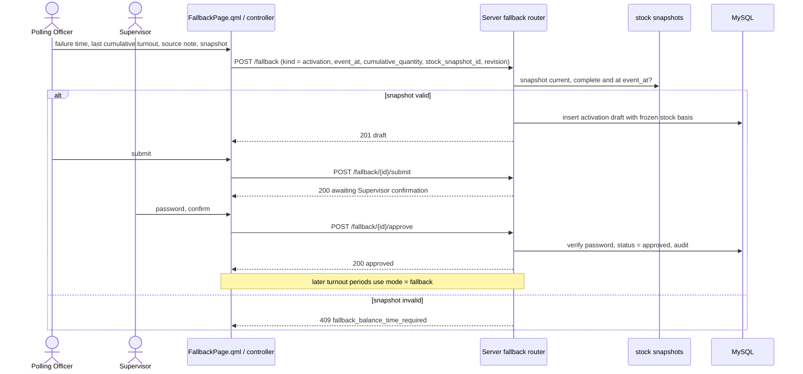
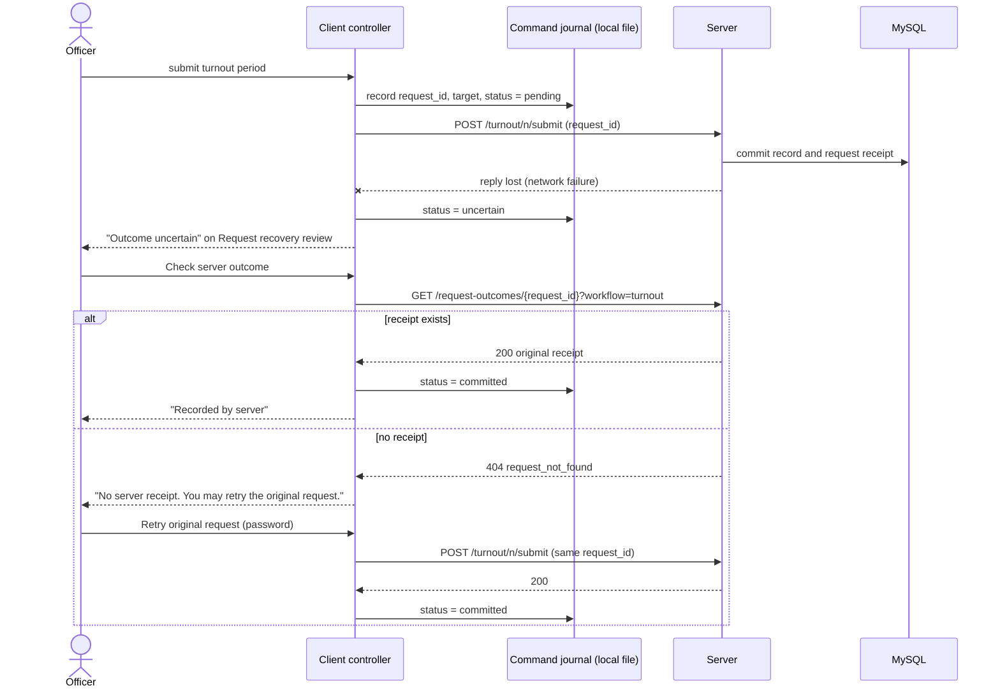

# 06. Failure handling: EPR fallback, outages, paper re-entry and request recovery

| Item | Value |
| --- | --- |
| Person in charge | Mody |
| Reference manual | "EPR system cannot run normally" (pp. 71–86) |
| Server code | `src/election/server/fallback.py`, `fallback_models.py`, `outages.py`, `outage_models.py`, `outage_reports.py`, `paper_reentry.py`, `paper_existing_receipt.py`, `request_outcomes.py` |
| Desktop code | `src/election/desktop/fallback.py`, `outages.py`, `paper_reentry.py`, `recovery.py`, `client_command_journal.py`, `qml/FallbackPage.qml`, `qml/OutagesPage.qml`, `qml/RecoveryPage.qml` |
| API | `/api/workspace/stations/{station_id}/fallback`, `/outages`, `/outages/{id}/paper-records`, `/outages/{id}/approve`, `/request-outcomes/{request_id}` |
| Former automated tests | `tests/test_fallback_activation_api.py`, `test_fallback_recovery_api.py`, `test_fallback_integrity_api.py`, `test_fallback_turnout_api.py`, `test_outage_reconciliation_api.py`, `test_outage_allocation_reentry_api.py`, `test_client_recovery_desktop.py`, `test_client_recovery_contract_desktop.py` (commit `c68fb54`) |

## 1. Failure scenarios covered

| Scenario | What fails | What staff do | System support |
| --- | --- | --- | --- |
| A. EPR fallback | The external electronic poll register; Election Desk still works | Turnout is calculated from ballot papers issued instead of read from the register | "EPR fallback" page; turnout mode `fallback` and `recovery` |
| B. Application outage | Network, server or database; Election Desk cannot save | Staff write on paper forms, then re-enter after the outage | "Connectivity outages and paper records" page |
| C. Uncertain request | A request was sent but the reply never arrived | Staff check whether the server recorded it before retrying | "Request recovery review" page |

## 2. User requirements

- UR-06.1 When the register fails, the officer activates fallback mode with the actual time of
  the failure and the last known cumulative turnout, and the Supervisor confirms it.
- UR-06.2 During fallback, the turnout of a period is calculated from ordinary ballot papers
  issued (P(14) and P(12)), not typed in.
- UR-06.3 When the register recovers, the officer records the recovered figure next to the
  stock-based figure; the difference stays visible.
- UR-06.4 When Election Desk itself was unavailable, every paper record made during the outage
  is entered afterwards with its original time, and the Supervisor reconciles paper against
  the system.
- UR-06.5 A lost reply must never lead to a duplicate record.

## 3. Functional requirements

EPR fallback:

| ID | Requirement | Role | Implemented in |
| --- | --- | --- | --- |
| FR-FBK-01 | The system shall record a fallback activation with the original event time, the cumulative turnout supplied at that moment, a note of the source, and a complete P(12) snapshot taken at exactly the same time. | Polling Officer | `POST /fallback` (`FallbackDraft`, `kind = activation`) |
| FR-FBK-02 | The system shall refuse an activation whose snapshot is at a different time, is not current, or does not report every issuing desk. | Polling Officer | 409 `fallback_balance_time_required`, 409 `fallback_review_required` (`turnout_basis.py`) |
| FR-FBK-03 | The system shall require Supervisor confirmation with password before an activation or recovery takes effect. | Supervisor | `POST /fallback/{id}/approve` |
| FR-FBK-04 | After a confirmed activation, the system shall calculate the turnout of a period as the activation figure plus ordinary papers issued since the activation snapshot, and shall not accept a typed figure for that period. | Polling Officer | `turnout.py` (`mode = fallback`; "Fallback turnout is calculated from ordinary stock") |
| FR-FBK-05 | The system shall exclude replacement and tendered papers from the calculated turnout. | Polling Officer | `turnout_basis.py` |
| FR-FBK-06 | The system shall record a recovery that refers to its confirmed activation and holds the recovered external figure, and shall show the stock-based figure, the recovered figure and their difference. | Polling Officer | `kind = recovery`; "Recovery comparison" |
| FR-FBK-07 | The system shall keep the earlier stock-based turnout revision when a period is renewed with the recovered figure. | Polling Officer, Supervisor | `turnout.py` (`mode = recovery`) |
| FR-FBK-08 | The system shall reject a new activation that overlaps a confirmed fallback interval. | Polling Officer | `fallback_source_conflict` |
| FR-FBK-09 | The system shall allow a correction of a confirmed activation or recovery only with a reason, and shall require renewed confirmation and review of dependent turnout periods. | Polling Officer | `POST /fallback/{id}/amend` |

Application outage and paper re-entry:

| ID | Requirement | Role | Implemented in |
| --- | --- | --- | --- |
| FR-OUT-01 | The system shall record an outage with reference, type (network, backend, database, unknown), actual start and end time, and notes. | Polling Officer, Counting Officer | `POST /outages` (`OutageDraft`) |
| FR-OUT-02 | The system shall register each paper record made during the outage with its paper reference, the time written on the paper, and the workflow it belongs to (count, turnout, counter allocation). | Polling Officer (turnout, allocation); Counting Officer (count) | `POST /outages/{id}/paper-records` |
| FR-OUT-03 | The system shall re-enter a paper record through the normal workflow exactly once and attach an immutable receipt to the paper reference. | Same | `paper_reentry.py` |
| FR-OUT-04 | The system shall let an officer link a paper reference to an entry that already reached the server before the outage was noticed, without creating a second entry. | Same | `POST /outages/{id}/paper-records/{paper_id}/link-receipt` |
| FR-OUT-05 | The system shall let a Supervisor approve the reconciliation of an outage only when every paper reference has been re-entered, with password and reason. | Supervisor | `POST /outages/{id}/approve` |
| FR-OUT-06 | The system shall export the outage and paper reconciliation report as CSV and PDF. | All operational roles | `outage_reports.py` |

Request recovery:

| ID | Requirement | Role | Implemented in |
| --- | --- | --- | --- |
| FR-REC-01 | The client shall keep a local journal of operational requests whose outcome is pending or uncertain. The journal shall never contain a password or token. | All operational roles | `client_command_journal.py` (`SENSITIVE_KEYS`) |
| FR-REC-02 | The system shall let the user check the server outcome of a journalled request by its request identifier. | All operational roles | `GET /request-outcomes/{request_id}` |
| FR-REC-03 | The client shall allow a retry of the original request only after the server has answered that no receipt exists, and shall never resend a request automatically. | All operational roles | `recovery.py` (`checkOutcome`, `retry`) |
| FR-REC-04 | The server shall answer 503 `database_unavailable` when the database cannot be reached and shall not leave a partial record. | — | `app.py` |

Non-functional requirements that apply: NFR-REL-02, NFR-REL-03, NFR-REL-04, NFR-SEC-02.

## 4. Use case UC-06: Work in EPR fallback mode and recover

| Field | Description |
| --- | --- |
| Actors | Polling Officer (primary); Supervisor (approver); electronic poll register (external, failed) |
| Description | The register stops working. The officer activates fallback mode so that turnout is calculated from ballot papers issued. When the register returns, the officer records the recovered figure. |
| Data | Failure time, last cumulative turnout from the register, P(12) snapshot at the failure time, source note; later the recovery time, recovered cumulative turnout and reason; Supervisor password |
| Stimulus | The register is unavailable at a station |
| Response | Turnout periods after the activation are stock-derived; after recovery the comparison of both figures is shown |
| Pre-condition | Allocations (P(14)) are up to date; the election is active |
| Post-condition | Confirmed activation and recovery records exist; every turnout period states how its figure was obtained |
| Comments | The time entered is the time the register failed, not the time the button is pressed (manual, step 2) |

Main flow:

1. The officer records a P(12) snapshot of every issuing desk at the failure time.
2. The officer opens "EPR fallback", selects "New fallback activation", enters the failure
   time, the last cumulative turnout and the source note, and selects the snapshot.
3. The officer saves and submits; the Supervisor confirms with their password.
4. For each later period the officer records a snapshot at the period end and prepares the
   turnout in fallback mode; the system calculates the figure.
5. When the register is back, the officer selects "Record external recovery", enters the
   recovered cumulative turnout and a reason; the Supervisor confirms.
6. The system shows the stock-derived figure, the recovered figure and the difference.

Alternative flows:

- 2a. The snapshot is at a different time or a desk is missing: the activation is refused.
- 4a. Ordinary papers issued are lower than at activation: the system reports a stock
  regression and the officer reviews the snapshots.
- 5a. The register never recovers: fallback mode continues to the close of poll.

## 5. Sequence diagrams

EPR fallback activation:

Uncertain request recovery:

## 6. Design notes

- Dependability approach (fault tolerance): detect (HTTP error or time-out), keep evidence
  (journal), assess (outcome check), recover (retry with the same identifier or paper
  re-entry). Recovery is always a deliberate user action.
- The idempotency receipt is stored in the same database transaction as the record, so
  "recorded" and "receipt exists" cannot disagree.
- Outage, paper reference and reconciliation each have their own revision number.
- The reference manual's instruction "do not make any change by yourself; call the helpdesk"
  is kept as a procedure; the system adds the audit trail.

## 7. Test cases

System tests (manual, on a rehearsal copy of the paper-ballot demo server, stage `polling`):

| ID | Requirement | Pre-condition | Steps | Expected result | Result |
| --- | --- | --- | --- | --- | --- |
| TC-FBK-01 | FR-FBK-01, FR-FBK-03 | Signed in as `demo_polling`; a complete snapshot exists | Open "EPR fallback"; "New fallback activation" with the snapshot's time, cumulative turnout 300, a source note; save; submit. Sign in as `demo_supervisor`; confirm with password. | Record becomes "Approved"; mode shows "Stock-derived fallback mode" | **PASS** — 2026-11-27, Election Desk v1.1.0. Activation 1 became Approved and the mode showed Stock-derived fallback mode. [Screenshot](evidence/mody/TC-FBK-01.png) |
| TC-FBK-02 | FR-FBK-02 | Signed in as `demo_polling` | Create an activation whose time differs from the snapshot time. | Refused with the balance-time message | **PASS (tester-reported)** — 2026-11-27, Election Desk v1.1.0. An activation whose time differed from the snapshot was refused with the balance-time message. |
| TC-FBK-03 | FR-FBK-03 | A submitted activation exists | As `demo_supervisor`, confirm with a wrong password. | Refused; status unchanged | **PASS (tester-reported)** — 2026-11-27, Election Desk v1.1.0. Confirmation with a wrong password was refused and the status stayed unchanged. |
| TC-OUT-01 | FR-OUT-01 | Signed in as `demo_polling` | Open "Connectivity outages and paper records"; "New outage record": reference, type "Network", start and end time on the election date; save. | Outage listed with revision 1 | **PASS** — 2026-11-27, Election Desk v1.1.0. The network outage was saved and listed at revision 1. [Screenshot](evidence/mody/TC-OUT-01.png) |
| TC-OUT-02 | FR-OUT-01 | Same | Save an outage whose start is after its end. | Rejected: start must not be after end | **PASS (tester-reported)** — 2026-11-27, Election Desk v1.1.0. An outage whose start was after its end was rejected. |
| TC-OUT-03 | FR-OUT-02, FR-OUT-05 | TC-OUT-01 done | Add a paper reference for workflow "Counter allocation"; do not re-enter it. As `demo_supervisor`, try to approve the reconciliation. | Approval refused: every paper reference must be re-entered first | **PASS (tester-reported)** — 2026-11-27, Election Desk v1.1.0. Reconciliation approval was refused until every paper reference had been re-entered. |
| TC-REC-01 | FR-REC-04, NFR-REL-04 | Client signed in | Stop the demo server (`docker compose ... stop`); try to save a queue observation; start the server again. | The client reports that the server is unavailable; after restart no duplicate or partial record exists | **PASS (tester-reported)** — 2026-11-27, Election Desk v1.1.0. While the server was stopped the client reported that it was unavailable, and the queue observation was not saved after restart. |
| TC-REC-02 | FR-REC-02 | Signed in as `demo_polling` | Open "Request recovery review". | The page lists retained requests, or states that there are none; nothing is resent automatically | **PASS (tester-reported)** — 2026-11-27, Election Desk v1.1.0. Request recovery review showed the retained requests, or stated that there were none, and nothing was resent automatically. |

Automated tests (unit / API level, from the project history):

| Test | Requirement |
| --- | --- |
| `test_fallback_activation_api.py::test_supervisor_confirms_frozen_fallback_activation_without_changing_normal_turnout` | FR-FBK-01, FR-FBK-03 |
| `test_fallback_integrity_api.py::test_fallback_rejects_wrong_time_foreign_stale_and_incomplete_sources_without_events` | FR-FBK-02 |
| `test_fallback_turnout_api.py::test_mixed_period_adds_five_ordinary_issues_without_counting_special_reserves` | FR-FBK-04, FR-FBK-05 |
| `test_fallback_recovery_api.py::test_recovered_116_replaces_approved_fallback_115_and_preserves_both_revisions` | FR-FBK-06, FR-FBK-07 |
| `test_fallback_mode_conflicts_api.py::test_confirmed_activation_rejects_overlapping_draft_and_new_activation` | FR-FBK-08 |
| `test_outage_reconciliation_api.py::test_paper_count_submission_reenters_once_and_supervisor_reconciles` | FR-OUT-03, FR-OUT-05 |
| `test_outage_allocation_reentry_api.py::test_existing_allocation_receipt_can_be_linked_to_create_paper_without_second_effect` | FR-OUT-04 |
| `test_client_recovery_desktop.py::test_committed_count_receipt_is_recovered_after_desktop_restart` | FR-REC-01, FR-REC-02 |
| `test_client_recovery_contract_desktop.py::test_retry_waits_for_an_explicit_not_found_outcome` | FR-REC-03 |
| `test_auth_api.py::test_database_outage_returns_a_safe_service_error` | FR-REC-04 |

## 8. Differences from the reference manual

| Manual | Election Desk | Reason |
| --- | --- | --- |
| Fallback is switched on in Settings and confirmed only in the :15–:30 window | Activation is a reviewed record with the actual failure time; no time window | The window is a reporting procedure; the system keeps the actual time and the Supervisor's confirmation |
| The activation period shows `##` and staff subtract by hand | The system derives the period figure from the activation figure and the snapshots | Removes manual arithmetic |
| Fixed order P(14) → P(12) → P(15) enforced by habit | A fallback turnout period cannot be prepared without a matching snapshot | The order is enforced by the data dependency |
| Only the register failure is described | Outage of Election Desk itself and lost replies are also covered | A system that records the fallback must itself be able to fail safely |
| The group's draft of this chapter is in note form ("ERP" for EPR) | `TODO(Mody)`: rewrite the chapter in the reference manual as full sentences and correct "ERP" to "EPR" | Quality of the report |

Mody's manual run used Election Desk v1.1.0 on 2026-11-27. The client was connected to a local paper-ballot rehearsal server at stage polling. TC-FBK-01 and TC-OUT-01 include screenshots. The other cases were reported by the tester without screenshot evidence.
