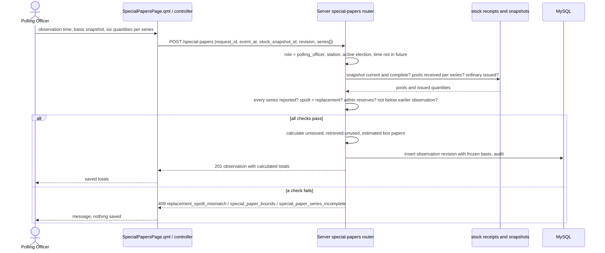

# 08. Tendered, spoilt and unused ballot papers

| Item | Value |
| --- | --- |
| Person in charge | Salina |
| Reference manual | 9.2 Enter tendered, spoilt and unused ballot papers (pp. 97–111) |
| Server code | `src/election/server/special_papers.py`, `special_paper_inventory.py`, `special_paper_models.py`, `special_paper_reports.py` |
| Desktop code | `src/election/desktop/special_papers.py`, `qml/SpecialPapersPage.qml` |
| API | `/api/workspace/stations/{station_id}/special-papers` (`GET`, `POST`, `PUT /{id}`, `GET /{id}/history`, `GET /{id}`, statement `.csv` / `.pdf`) |
| Former automated tests | `tests/test_special_papers_api.py` and related `test_special_paper_*` files (commit `c68fb54`) |

## 1. Terms

| Term (GLOSSARY.md) | Meaning |
| --- | --- |
| Tendered ballot paper (重複選票) | Issued from the tendered reserve to an elector whose name was already marked as having voted |
| Spoilt original (損壞選票) | A ballot paper spoilt by the elector and surrendered |
| Replacement ballot paper | Issued from the replacement reserve in exchange for a surrendered spoilt original |
| Retrieved-unused ballot paper (未用選票) | An issued ordinary paper that did not go into the box: refused by the elector, found in the station, or held pending the elector's return |
| Unissued stock | Papers that never left the presiding officer or an issuing desk |

## 2. User requirements

- UR-08.1 After the poll the polling officer enters the numbers of tendered, spoilt and unused
  ballot papers, and the system calculates the totals.
- UR-08.2 The figures can be entered and corrected several times before the ballot paper
  account (P(18)) is prepared.
- UR-08.3 The figures must be consistent with the stock the station received and issued.

## 3. Functional requirements

| ID | Requirement | Role | Implemented in |
| --- | --- | --- | --- |
| FR-SPP-01 | The system shall record a special-paper observation with observation time and, for each ballot series received, six entered quantities: replacement papers issued, spoilt originals surrendered, tendered papers issued, and retrieved-unused papers refused, found and held. | Polling Officer | `POST /special-papers` (`SpecialPaperInput`) |
| FR-SPP-02 | The system shall base each observation on one current and complete P(12) snapshot and take the ordinary papers issued from it. | Polling Officer | `stock_snapshot_id`, `stock_snapshot_revision`; 409 `stock_snapshot_basis_stale`, `stock_snapshot_incomplete` |
| FR-SPP-03 | The system shall calculate, for each series and for the station: total retrieved-unused papers, unissued ordinary papers, unused replacement reserve, unused tendered reserve, total never-issued stock, and the number of ballot papers expected in the boxes (ordinary issued minus retrieved-unused). | Polling Officer | `special_papers.py` (`QUANTITIES`) |
| FR-SPP-04 | The system shall reject an observation in which replacement papers issued differ from spoilt originals surrendered. | Polling Officer | 409 `replacement_spoilt_mismatch` |
| FR-SPP-05 | The system shall reject quantities that exceed their source: replacement or tendered papers issued above the reserve received, or retrieved-unused papers above ordinary papers issued. | Polling Officer | 409 `special_paper_bounds` |
| FR-SPP-06 | The system shall require every received series to be reported exactly once. | Polling Officer | 409 `special_paper_series_incomplete` |
| FR-SPP-07 | The system shall reject a later observation that reports fewer replacement or tendered papers issued than an earlier one. | Polling Officer | 409 `special_paper_issuance_regression` |
| FR-SPP-08 | The system shall treat "no observation saved" and "observation saved with zero" as different states. | Polling Officer | `special_papers.py`; "Set all counts to zero" |
| FR-SPP-09 | The system shall allow a correction only with a reason and shall keep the earlier revision. | Polling Officer | `PUT /special-papers/{id}` (`SpecialPaperCorrection`) |
| FR-SPP-10 | The system shall not change turnout or ordinary stock when special papers are recorded. | — | `special_papers.py` |
| FR-SPP-11 | The system shall export the selected special-paper statement as CSV and PDF. | All operational roles | `special_paper_reports.py` |

Non-functional requirements that apply: NFR-DATA-01, NFR-REL-01, NFR-REL-02, NFR-SEC-04.

Calculation rules (per series):

```
retrieved_unused        = refused + found + held
ordinary_unissued       = ordinary_received − ordinary_issued
replacement_unissued    = replacement_received − replacement_issued
tendered_unissued       = tendered_received − tendered_issued
never_issued            = ordinary_unissued + replacement_unissued + tendered_unissued
estimated_box_papers    = ordinary_issued − retrieved_unused
constraint              : spoilt_originals = replacement_issued
```

A replacement paper takes the place of the spoilt original, so the pair is not deducted from
the box estimate twice.

## 4. Use case UC-08: Account for special ballot papers after the poll

| Field | Description |
| --- | --- |
| Actors | Polling Officer |
| Description | After the close of poll the officer counts the tendered, spoilt and unused ballot papers held at the station and records them. |
| Data | Observation time; per series: replacement issued, spoilt originals, tendered issued, retrieved-unused (refused, found, held); the P(12) snapshot used as basis |
| Stimulus | The poll has closed and the final P(12) snapshot has been saved |
| Response | The saved observation shows the calculated totals, including the estimated number of papers in the boxes |
| Pre-condition | Stock receipt, allocations and a complete final snapshot exist |
| Post-condition | A special-paper revision exists that the ballot paper account (P(18), document 09) can refer to |
| Comments | The observation may be amended repeatedly until the account is approved; after approval a change makes the account need review |

Main flow:

1. The officer opens "Special ballot stock accounting" and selects "New special-paper
   observation".
2. The officer chooses the final snapshot as the basis.
3. For each series the officer enters the six quantities (or "Set all counts to zero").
4. The system checks the quantities against stock and calculates the totals.
5. The officer saves; the system shows the saved totals.

Alternative flows:

- 2a. The snapshot is not the current revision or misses a desk: the system refuses it.
- 4a. Spoilt originals differ from replacements issued: the system rejects the observation.
- 4b. A quantity exceeds its reserve: the system rejects the observation.
- 5a. The officer finds a miscount: "Prepare a reasoned amendment", change, give a reason.

## 5. Sequence diagram



## 6. Design notes

- The observation is cumulative for the station at its observation time, not a list of single
  events.
- It stores the snapshot revision and the stock receipt revisions it used. The ballot paper
  account (P(18)) refers to one special-paper revision.
- Demo data: one observation with all quantities zero; received 520, ordinary issued 300,
  estimated box papers 300, never-issued stock 220.

## 7. Test cases

System tests (manual, on a rehearsal copy of the paper-ballot demo server, stage `polling`). Do not amend
the seeded observation on the demo used for the video: the importer keeps its revision number
and the later stages are built on it.

| ID | Requirement | Pre-condition | Steps | Expected result | Result |
| --- | --- | --- | --- | --- | --- |
| TC-SPP-01 | FR-SPP-03, FR-SPP-08 | Signed in as `demo_polling` | Open "Special ballot stock accounting"; select the seeded observation. | All entered quantities 0; total received 520; ordinary issuance 300; never-issued stock 220; estimated box papers 300 | **NOT RUN** - due to phtsical ballot server not available |
| TC-SPP-02 | FR-SPP-04 | Same | Prepare an amendment with replacement papers issued = 2 and spoilt originals = 1, with a reason. | Rejected: replacements and spoilt originals must match | **NOT RUN** - due to phtsical ballot server not available |
| TC-SPP-03 | FR-SPP-05 | Same | Prepare an amendment with tendered papers issued = 11 (reserve is 10). | Rejected: exceeds the reserve | **NOT RUN** - due to phtsical ballot server not available |
| TC-SPP-04 | FR-SPP-09 | Same | Prepare an amendment with replacement = 1, spoilt = 1, tendered = 1, refused = 2; first without a reason, then with a reason. | Without reason: rejected. With reason: revision 2 saved; unused replacement reserve 9; unused tendered reserve 9; estimated box papers 298 | **NOT RUN** - due to phtsical ballot server not available |
| TC-SPP-05 | FR-SPP-10 | TC-SPP-04 done | Open "Period turnout". | Approved turnout is still 300 | **NOT RUN** - due to phtsical ballot server not available |
| TC-SPP-06 | FR-SPP-11 | Same | Export the statement as PDF in Traditional Chinese. | The file shows the saved revision and its basis | **NOT RUN** - due to phtsical ballot server not available |

Equivalence partitions for tendered papers issued (reserve 10): negative (invalid), 0 to 10
(valid; test 0 and 10), above 10 (invalid; test 11), not a whole number (invalid).

Status (28 Nov 2027 by Salina): Manual Test cases TC-SPP-01 to TC-SPP-06 were **NOT RUN** as paper-ballot server is not yet deployed in this stage. These cases will be examine in next release when the pyhsical pallot server is available.


Automated tests (unit / API level, from the project history):

| Test | Requirement |
| --- | --- |
| `test_special_papers_api.py::test_officer_accounts_for_special_papers_without_reissuing_stock_or_adding_turnout` | FR-SPP-01, FR-SPP-03, FR-SPP-10 |
| `test_accounting_edges_api.py::test_corrected_special_source_invalidates_approval_without_changing_frozen_values` | FR-SPP-09 (effect on P(18)) |
| `test_accounting_freshness_api.py::test_older_cumulative_special_observation_is_not_offered_as_current_p18_source` | FR-SPP-07 |


## 8. Differences from the reference manual

| Manual | Election Desk | Reason |
| --- | --- | --- |
| Three figures: tendered, spoilt, unused | Six entered quantities; "unused" is split into refused, found and held | The three kinds of retrieved-unused paper are separate lines on the ballot paper account |
| System "calculates the total" | System also checks the figures against received stock and the P(12) snapshot | An impossible figure is stopped at entry, not at the count |
| Page can be re-saved freely until P(18) is filled in | Each change is a new revision with a reason | Audit trail |
| Reserves of 100 tendered and 100 spoilt sets | Reserve sizes come from the stock receipt | Configurable |
