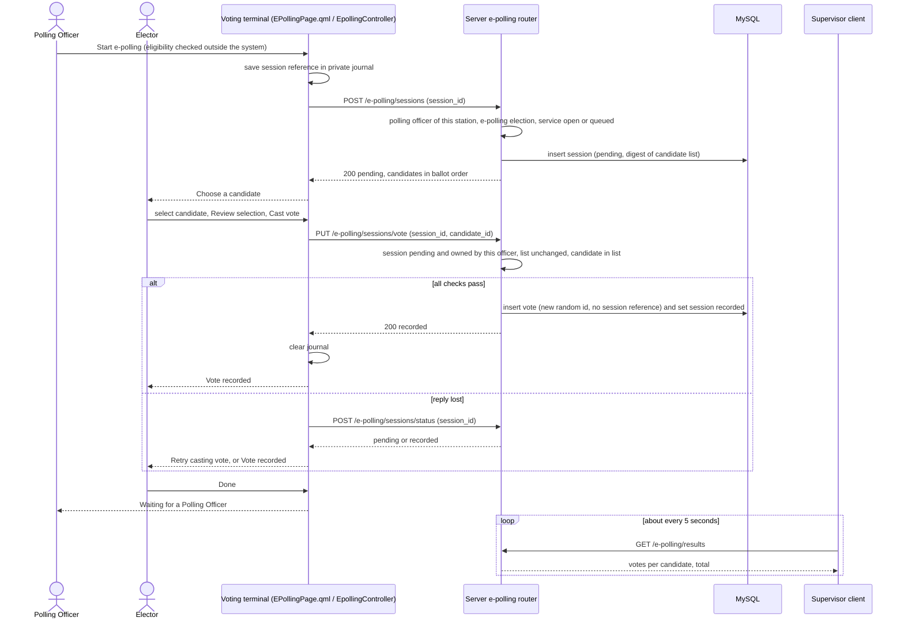
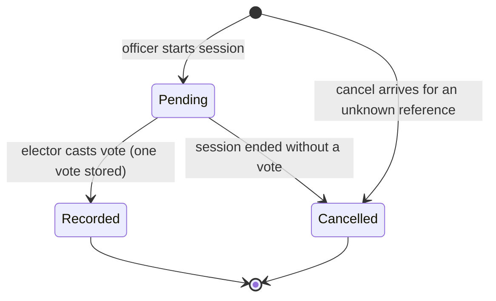

# 14. E-polling: in-person electronic voting

| Item | Value |
| --- | --- |
| Person in charge | Dennis |
| Reference manual | None. The manual describes paper-ballot polling only; this module is the "Voting System" part of the topic |
| Added in | Release `v1.1.0`, commit `f5105cb` ("add live e-polling results and successive voter sessions"), migration `0036_electronic_voting` |
| Server code | `src/election/server/epolling.py`, `epolling_models.py`; `voting_service()` in `polling.py`; `require_paper_election()` in `station_access.py`; `voting_method` in `configuration.py` and `lifecycle.py` |
| Desktop code | `src/election/desktop/epolling.py`, `epolling_recovery.py`, `epolling_results.py`, `qml/EPollingPage.qml`, `qml/EPollingResultsPage.qml`, `qml/Main.qml` (voter mode) |
| API | `/api/workspace/stations/{station_id}/e-polling`: `POST /sessions`, `PUT /sessions/vote`, `POST /sessions/cancel`, `POST /sessions/status`, `GET /results` |
| Automated tests | None. The test suite was removed from the repository before this function was written (document 12, section 3) |

## 1. Terms

| Term (GLOSSARY.md) | Meaning |
| --- | --- |
| E-polling (電子投票) | In-person polling in which electors select a candidate and cast an electronic vote on screen at the polling station |
| Voting method | A property of an election: physical ballots (`paper`) or e-polling (`electronic`) |
| Voting session | A Polling Officer's single-use authorisation for one elector to cast one electronic vote at the officer's station |
| Electronic vote | An elector's confirmed choice of one candidate of the constituency |
| Voting terminal | A desktop client that a Polling Officer has put into voter mode |
| Voting service | State of a station derived from its approved polling records: not open, open, queued (admission closed, queue still served), ended |

E-polling is voting at a polling station on a terminal controlled by staff. It is not remote or
online voting.

## 2. User requirements

- UR-14.1 An administrator decides for each election whether electors vote on paper or on
  screen.
- UR-14.2 After checking that an elector may vote, a polling officer opens a private voting
  screen for that elector. The elector chooses one candidate, reviews the choice and casts the
  vote. The officer then opens the screen for the next elector without signing in again.
- UR-14.3 A vote is counted once, even if the network fails while it is being sent.
- UR-14.4 Nobody can find out from the system which elector, session or officer a vote
  belongs to.
- UR-14.5 The supervisor can watch the running totals of the station.

## 3. Functional requirements

| ID | Requirement | Role | Implemented in |
| --- | --- | --- | --- |
| FR-EPL-01 | The system shall let the Administrator choose the voting method of an election (physical ballots or e-polling) while the election is a draft. The default shall be physical ballots, and elections that existed before v1.1.0 shall remain physical-ballot elections. | Administrator | `configuration.py` (`voting_method`, 409 `draft_required`); migration `0036_electronic_voting` (`server_default="paper"`); `qml/ConfigurationSection.qml` |
| FR-EPL-02 | The system shall allow an e-polling election to be activated without issuing desks. A physical-ballot election shall still need at least one issuing desk for every station. | Administrator | `lifecycle.py` `complete_configuration` |
| FR-EPL-03 | In an e-polling election the system shall reject writes to paper-only records (stock receipts, allocations, snapshots and counter returns, special ballot papers, turnout, EPR fallback, ballot boxes, stock accounting, counting scopes) and shall not show their pages. | Polling Officer, Counting Officer, Supervisor | `station_access.py` 409 `paper_election_required`, called from `stock_scope`, `turnout_scope` and the box router; `Main.qml` `electronicElection` |
| FR-EPL-04 | The system shall start a voting session only for a Polling Officer assigned to the station, only in an active e-polling election, and only while the voting service of the station is open or queued (an approved opening exists and no approved end of service). | Polling Officer | `epolling.py` `start`; 403 `polling_officer_required`, 409 `epolling_not_enabled`, 409 `epolling_service_closed` |
| FR-EPL-05 | On starting a session the system shall return the candidates of the station's constituency in ballot-number order. If the constituency has no candidate it shall refuse the session. | Polling Officer | `current_candidates`; 409 `epolling_no_candidates` |
| FR-EPL-06 | The system shall record exactly one electronic vote for one candidate of the constituency when the elector casts the vote, and shall mark the session as recorded. A candidate outside the list shall be rejected. | Elector (through the terminal) | `PUT /sessions/vote`; 422 `epolling_candidate_unavailable` |
| FR-EPL-07 | The system shall count a session at most once. Repeating the cast request of a recorded session, or the start request of a finished session, shall return its status and shall not create another vote. | Elector, Polling Officer | `cast` and `start` return `{"status": ...}`; row lock on the session |
| FR-EPL-08 | The system shall refuse a vote when the candidate list has changed since the session started, so that the elector never votes on an outdated list. | Elector | `candidate_list_digest`; 409 `epolling_candidates_changed` |
| FR-EPL-09 | The system shall allow a session to be ended without a vote. A cancelled session shall not accept a vote. Cancelling an unknown session reference shall register it as cancelled, so that a delayed start request cannot open it later. | Polling Officer, Elector | `POST /sessions/cancel`; 409 `epolling_session_cancelled` |
| FR-EPL-10 | The system shall store an electronic vote with election, constituency, station and candidate only, under its own random identifier, with no reference to the session, the officer, the elector or the time. | — | `epolling_models.py` `ElectronicVote` |
| FR-EPL-11 | The voting screen shall take the elector through three steps: choose one candidate, review the choice with the warning that it is final, cast the vote. The elector shall be able to change the selection until the vote is cast. While the screen is in voter mode the staff navigation, the connection status, "Refresh" and the footer shall be hidden; the language menu shall stay available to the elector. | Elector | `qml/EPollingPage.qml`; `Main.qml` `voterMode` |
| FR-EPL-12 | After a vote is recorded the terminal shall wait for the Polling Officer, who shall be able to start the next voter's session on the same terminal without signing in again, or return to staff sign-in. | Polling Officer | `epolling.py` `done`, `startNext`, `exit` |
| FR-EPL-13 | Before sending a session to the server the terminal shall save only the session reference (server, station, session identifier) in a private local file. The chosen candidate shall be kept in memory only. After a lost reply the terminal shall check the session status and offer to retry the confirmed choice. After a restart it shall check the open session and end it if no vote was recorded. | Elector, Polling Officer | `epolling_recovery.py` `VotingSessionJournal`; `epolling.py` `checkStatus`, `retryCast` |
| FR-EPL-14 | The system shall allow only one voting screen for each client state directory, and shall tell the user when another window is already handling a session. | Polling Officer | `QLockFile` in `epolling_recovery.py`; `epolling_screen_busy` |
| FR-EPL-15 | The system shall show a Supervisor assigned to the station the number of electronic votes for each candidate and the station total, refreshed automatically about every five seconds and on request. No other role shall be able to read the totals. | Supervisor | `GET /results`; 403 `supervisor_required`; `epolling_results.py`; `qml/EPollingResultsPage.qml` |
| FR-EPL-16 | The system shall let a Polling Officer assigned to the station ask for the status (pending, recorded, cancelled) of a session by its reference, so that a replacement officer can resolve an interrupted session. | Polling Officer | `POST /sessions/status`; 404 `epolling_session_not_found` |

Related non-functional requirement: NFR-PRIV-01 (ballot secrecy) in `00-overview.md`.

## 4. Use case UC-11: Cast an electronic vote

| Field | Description |
| --- | --- |
| Actors | Elector (primary), Polling Officer, Supervisor (observer) |
| Description | An elector votes on a terminal that a polling officer has opened for that elector. |
| Data | Session reference (generated by the terminal); the chosen candidate |
| Stimulus | The officer has checked the elector's eligibility outside the system and selects "Start e-polling" or "Start next voter" |
| Response | "Vote recorded"; the station total seen by the supervisor increases by one |
| Pre-condition | The election is active and uses e-polling; the opening of the station is approved; the officer is signed in and assigned to the station |
| Post-condition | One electronic vote exists; the session is recorded and cannot be used again; the vote cannot be linked to the session |
| Comments | Eligibility checking and prevention of a second vote by the same elector are done by the officer, not by the system (section 8) |

Main flow:

1. The officer signs in, selects the station and opens "Polling operations".
2. The officer checks the elector's eligibility and selects "Start e-polling".
3. The terminal switches to voter mode and shows "Choose a candidate".
4. The elector selects one candidate and selects "Review selection".
5. The terminal shows the choice and the warning "Once you cast your vote, your choice is
   final". The elector selects "Cast vote".
6. The server records the vote. The terminal shows "Vote recorded".
7. The elector selects "Done" and leaves. The terminal shows "Waiting for a Polling Officer".
8. The officer checks the next elector and selects "Start next voter". Continue at step 3.

Alternative flows:

- 2a. The opening is not approved, or voting service has ended: "Start e-polling" is not
  available and the reason is shown.
- 5a. The elector selects "Change selection" and returns to step 4.
- 4b. The elector or officer selects "End voting session": the session is cancelled and no
  vote is recorded.
- 6a. The reply is lost: the terminal checks the session. If the vote was recorded it shows
  "Vote recorded"; if not it offers "Retry casting vote".
- 6b. The candidate list changed during the session: the session ends and the officer starts
  a new one.
- 8a. The officer selects "Return to staff sign-in" to leave voter mode.

Supervisor flow: the supervisor signs in on another client, opens "Live e-polling results" and
selects the station. The totals refresh without any action.

## 5. Models

### 5.1 Sequence diagram



### 5.2 State model: voting session



A recorded or cancelled session keeps no candidate-list digest (database check constraint
`ck_electronic_voting_session_status`).

## 6. Design notes

- Data model: two new tables. `electronic_voting_sessions` (id, station, officer account,
  status, candidate-list digest) and `electronic_votes` (id, election, constituency, station,
  candidate). `elections` gains the column `voting_method`.
- Ballot secrecy by design: the vote row gets a new random identifier and is written in the
  same transaction that marks the session recorded, but holds no reference to it. Neither
  table has a time column. The terminal's journal file never contains the candidate.
- Exactly-once: the session identifier is generated by the terminal and plays the role of the
  request identifier used elsewhere in the system (NFR-REL-02). The session row is locked
  while a vote is recorded.
- Reuse of existing design: station assignment (FR-SYS-02), the single active election
  (FR-SYS-03) and the approved opening record of module 02 decide whether voting is allowed.
  No second authorisation mechanism was added.
- Compatibility: migration `0036_electronic_voting` must be applied before v1.1.0 clients
  connect; it keeps existing elections as physical-ballot elections.
- Demo data (`prepare_demo.py start`, default): an active e-polling election, station Harbour
  Community Hall with an approved opening, candidates Alex Chan and Jamie Wong, and the extra
  account `demo_epolling` (a Polling Officer used as the voting terminal).

## 7. Test cases

System tests (manual, on a rehearsal copy of the e-polling demo server). Start a separate copy
so that the tally of the demo used for the video stays at zero:

```sh
uv run --locked python scripts/prepare_demo.py start --directory .runtime/epolling-rehearsal --port 8447
uv run --locked --directory src python -m election.desktop --server https://localhost:8447 --ca ../.runtime/epolling-rehearsal/ca.pem
```

Passwords are in `.runtime/epolling-rehearsal/ACCOUNTS.md`. The cases can also be run on the
shared e-polling server of the group (document 12, section 4.1), except TC-EPL-10 and
TC-EPL-13, which stop the service for every member. Use English from the Language menu
so that the labels match this table. Keep a second client open as `demo_supervisor` on "Live
e-polling results" and write down the total before each case.

If `ELECTION_CLIENT_STATE_DIR` is set, the folder must be private to the user (on macOS and
Linux: `chmod 700 <folder>`). With a folder that other users can read, "Start e-polling"
fails with "The local voting recovery record is unavailable" and no session is created.

Dry run on the shared server (21 Nov 2026, v1.1.0 client, by the author of this document
pack, not by a group member): TC-EPL-01 to 06, 09, 11 and 12 behaved as the table says;
three test votes were added (total 1 to 4). This is not a group test result. Each member
still runs the cases and fills the Result column.

**Recorded run — 28 November 2026, 00:06–00:14 HKT.** Run Election Desk v1.1.0 client on macOS on the shared demo at Harbour Community Hall
(`DEMO-S01`). The station was serving queued electors. Eleven desktop cases and one
v1.1.0 source inspection passed. TC-EPL-10 and TC-EPL-13 were left unrun.

The Supervisor’s station total before TC-EPL-01 and 02 was **4** (Alex Chan 2, Jamie Wong 2).
Before TC-EPL-03 through 06 it was **5** (Alex 3, Jamie 2). The two casts in TC-EPL-02
and 06 brought the total to **6** (Alex 3, Jamie 3), which was observed for TC-EPL-07
through 09, 11 and 12 and again before sign-out.

| ID | Requirement | Pre-condition | Steps | Expected result | Result |
| --- | --- | --- | --- | --- | --- |
| TC-EPL-01 | FR-EPL-04, FR-EPL-05, FR-EPL-11 | Signed in as `demo_epolling`; station Harbour Community Hall selected | Open "Polling operations"; select "Start e-polling". | The window shows "Choose a candidate" with Alex Chan and Jamie Wong in ballot-number order; the staff navigation, connection status and "Refresh" are not visible; the Language menu is still visible | **Pass.** The terminal switched to “Choose a candidate”, with 1 · Alex Chan followed by 2 · Jamie Wong. Language remained available. The staff navigation, connection status, Refresh and footer disappeared. [Queued station](evidence/dennis-e-polling/TC-EPL-01-station.jpg) · [Voter screen](evidence/dennis-e-polling/TC-EPL-01.jpg) |
| TC-EPL-02 | FR-EPL-06, FR-EPL-11 | TC-EPL-01 done | Select Alex Chan; "Review selection"; "Cast vote". | "Vote recorded"; supervisor total increases by exactly 1 and Alex Chan by 1 | **Pass.** The Alex Chan review showed the final-choice warning. After “Cast vote”, the terminal showed “Vote recorded”. The station went from 4 to 5 and Alex from 2 to 3. Jamie stayed at 2. [Baseline](evidence/dennis-e-polling/TC-EPL-02-baseline.jpg) · [Review](evidence/dennis-e-polling/TC-EPL-02-review.jpg) · [Recorded](evidence/dennis-e-polling/TC-EPL-02-recorded.jpg) · [Tally after cast](evidence/dennis-e-polling/TC-EPL-02-after.jpg) |
| TC-EPL-03 | FR-EPL-12 | TC-EPL-02 done | Select "Done"; then "Start next voter". | First "Waiting for a Polling Officer"; then a new "Choose a candidate" screen with no candidate selected; no sign-in was needed | **Pass.** “Done” showed “Waiting for a Polling Officer”. “Start next voter” opened a fresh ballot with both candidates unselected and “Review selection” disabled, within the same sign-in. [Waiting](evidence/dennis-e-polling/TC-EPL-03-waiting.jpg) · [Next ballot](evidence/dennis-e-polling/TC-EPL-03-next.jpg) |
| TC-EPL-04 | FR-EPL-11 | A session at "Choose a candidate" | Select Jamie Wong; "Review selection"; "Change selection"; select Alex Chan; "Review selection" (do not cast yet). | The review shows Alex Chan; supervisor total has not changed | **Pass.** The first review showed Jamie Wong. After “Change selection”, the second review showed Alex Chan. The Supervisor still saw 5 votes (Alex 3, Jamie 2). [First review](evidence/dennis-e-polling/TC-EPL-04-first-review.jpg) · [Changed review](evidence/dennis-e-polling/TC-EPL-04-changed-review.jpg) · [Tally](evidence/dennis-e-polling/TC-EPL-04-tally.jpg) |
| TC-EPL-05 | FR-EPL-09 | A session at "Choose a candidate" | Select "End voting session" and confirm. | The terminal returns to waiting; supervisor total has not changed | **Pass.** Confirming “End voting session” returned the terminal to “Waiting for a Polling Officer”. The station total stayed at 5 (Alex 3, Jamie 2). [Confirmation](evidence/dennis-e-polling/TC-EPL-05-confirm.jpg) · [Waiting](evidence/dennis-e-polling/TC-EPL-05-waiting.jpg) · [Tally](evidence/dennis-e-polling/TC-EPL-05-tally.jpg) |
| TC-EPL-06 | FR-EPL-15 | Second client signed in as `demo_supervisor` on "Live e-polling results" | Cast one vote on the terminal; do not touch the supervisor client. | Within about 5 seconds the total and the candidate's figure increase by 1; "Tally last updated" changes | **Pass.** The untouched Supervisor window showed 6 votes about 3.3 seconds after the Jamie Wong cast, up from 5. Jamie rose from 2 to 3 and Alex stayed at 3. The displayed tally update time advanced. [Before](evidence/dennis-e-polling/TC-EPL-06-before.jpg) · [Vote recorded](evidence/dennis-e-polling/TC-EPL-06-recorded.jpg) · [Automatic update](evidence/dennis-e-polling/TC-EPL-06-after.jpg) |
| TC-EPL-07 | FR-EPL-15, NFR-SEC-04 | Signed in as `demo_polling`, then as `demo_counting` | Look for "Live e-polling results" in the navigation. | The page is not offered to either role | **Pass.** “Live e-polling results” was absent from the navigation of both demo_polling and demo_counting. The Supervisor had used that page to observe the votes. [Polling Officer](evidence/dennis-e-polling/TC-EPL-07-polling.jpg) · [Counting Officer](evidence/dennis-e-polling/TC-EPL-07-counting.jpg) |
| TC-EPL-08 | FR-EPL-03 | Signed in as `demo_polling` | Read the navigation. | Polling operations, complaints, queue and outages are present; stock, allocations, snapshots, turnout, fallback, boxes, accounting and count pages are absent | **Pass.** The Polling Officer could see Polling operations, both complaint pages, Queue waiting times, and Connectivity outages and paper records. The paper stock, allocation, snapshot, turnout, fallback, box, accounting and counting pages were absent. [Navigation](evidence/dennis-e-polling/TC-EPL-08.jpg) |
| TC-EPL-09 | FR-EPL-01 | Signed in as `demo_admin` | Open "Election setup" and select the election. | "Voting method" shows "E-polling" and cannot be changed, because the election is active | **Pass.** In Election setup, the selected election showed “Active · Revision 2” and “E-polling”. The voting method selector and “Save election” were disabled. The page identified the election as view-only. [Administrator setup](evidence/dennis-e-polling/TC-EPL-09.jpg) |
| TC-EPL-10 | FR-EPL-07, FR-EPL-13, NFR-REL-02 | A session at "Choose a candidate"; note the supervisor total | Stop the server (`docker compose -f .runtime/epolling-rehearsal/config.yml stop`); select a candidate, review and cast; run the rehearsal `start` command above again to resume the server; follow the screen ("Check vote status" or "Retry casting vote"). | The terminal does not show "Vote recorded" while the server is down. After recovery the total has increased by exactly 1, not 0 and not 2 | **Not run.** The loss-of-reply and exactly-once recovery check requires stopping and restarting an isolated rehearsal server. |
| TC-EPL-11 | FR-EPL-13 | A session at "Choose a candidate" (nothing cast) | Close the client window; start the client again; sign in as `demo_epolling`. | The pending record in the state folder is removed and the window goes straight to "Waiting for a Polling Officer" (the interrupted session is ended without a vote); supervisor total has not changed; a new session can be started | **Pass.** The pending record survived quitting the uncast terminal. After restart and sign-in, the client checked the session and went directly to the officer waiting screen. The pending file was gone, the tally stayed at 6, and “Start next voter” opened an empty ballot. [Before quit](evidence/dennis-e-polling/TC-EPL-11-before-close.jpg) · [Recovered](evidence/dennis-e-polling/TC-EPL-11-recovered.jpg) · [Tally](evidence/dennis-e-polling/TC-EPL-11-tally.jpg) · [New ballot](evidence/dennis-e-polling/TC-EPL-11-new-session.jpg) |
| TC-EPL-12 | FR-EPL-14 | Terminal in voter mode (any stage, including "Waiting for a Polling Officer") | Start a second client on the same computer without setting `ELECTION_CLIENT_STATE_DIR`; sign in as `demo_polling`; "Start e-polling". | "Another Election Desk window is handling a voting session."; the second window stays on the staff page and the supervisor total has not changed | **Pass.** With the first terminal waiting, demo_polling clicked “Start e-polling” in another client using the default state directory. It stayed on the staff page and reported “Another Election Desk window is handling a voting session.” The tally stayed at 6. [Second window](evidence/dennis-e-polling/TC-EPL-12-locked.jpg) · [Tally](evidence/dennis-e-polling/TC-EPL-12-tally.jpg) |
| TC-EPL-13 | FR-EPL-04 | Run last. As `demo_polling` record and submit "Closure to new arrivals" and then "Completion of service to queued electors"; approve each as `demo_supervisor` (document 02) | As `demo_epolling` open "Polling operations". | "Start e-polling" is not available; "Voting service has ended at this station." | **Not run.** Approving completion of service at this station would end voting for everyone on the shared demo. |
| TC-EPL-14 | FR-EPL-10, NFR-PRIV-01 | Source code of v1.1.0 | Inspect `ElectronicVote` in `epolling_models.py` and the table created by migration `0036_electronic_voting`. | Columns are id, election, constituency, station and candidate only; no session, account or time column | **Pass (source inspection).** The tagged v1.1.0 model and migration both define exactly five vote columns: `id`, `election_id`, `constituency_id`, `station_id` and `candidate_id`. Neither contains a session, account or timestamp column. [Model](https://github.com/dennisngan/election-management-and-voting-system/blob/f5105cb92c4eddb447f38a5f86dc8d71b364f5d5/src/election/server/epolling_models.py#L27-L36) · [Migration](https://github.com/dennisngan/election-management-and-voting-system/blob/f5105cb92c4eddb447f38a5f86dc8d71b364f5d5/migrations/versions/0036_electronic_voting.py#L37-L48) |

Equivalence partitions for the voting service state (FR-EPL-04): not open (invalid), open
(valid), queued (valid), ended (invalid). The shared-server run of TC-EPL-01 exercised “queued”. A fresh station with approved opening
and no approved closure is needed to exercise “open”. The “not open” and “ended” states
remain untested in this run.

Requirements without a test case: FR-EPL-02, FR-EPL-08 and FR-EPL-16 need a second election or
a direct API call. They are listed as gaps in document 11.

Automated tests: none exist for this module. Unit tests should cover `voting_service()` and the
session state rules; API tests should cover every error code in section 3 (CR-13 in document 13).

## 8. Limits of release v1.1.0

The application itself states that "electronic turnout, results, and finalization are outside
this demo". From the source code:

| Limit | Consequence | Change request |
| --- | --- | --- |
| The system holds no register of electors. Eligibility and "one elector, one vote" are checked by the officer before starting a session | The system prevents a second vote in one session, not a second session for the same elector | CR-14 |
| E-polling totals are provisional station totals for the Supervisor. They do not feed turnout reports, constituency results or election completion | An e-polling election cannot be finalised with a result statement in v1.1.0 | CR-15 |
| Starting, cancelling and casting write no audit event | FR-SYS-07 (audit of every write) does not hold for e-polling; the number of sessions and votes is not reported | CR-16 |
| The Supervisor can see running totals while the poll is open | A real election would normally hide results until the close of poll | CR-16 |
| There is no paper record or receipt of an electronic vote | A recount can only repeat the database query | CR-17 |
| No automated tests | Regression risk for the most sensitive function | CR-13 |
